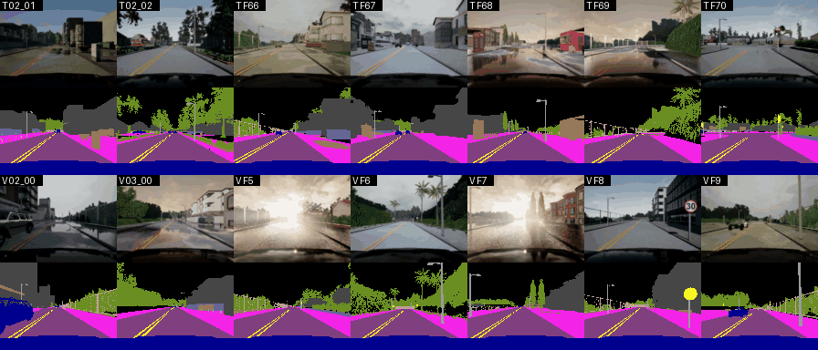
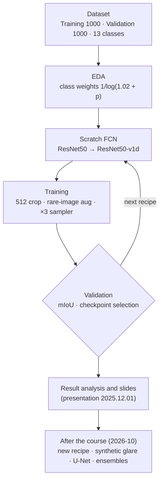
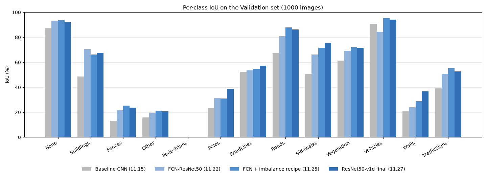
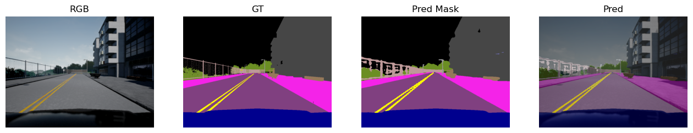
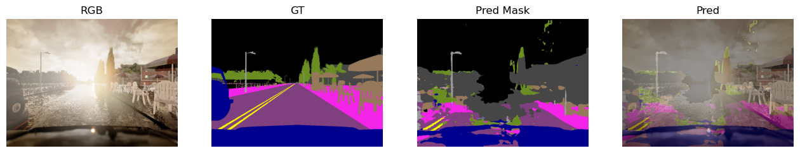
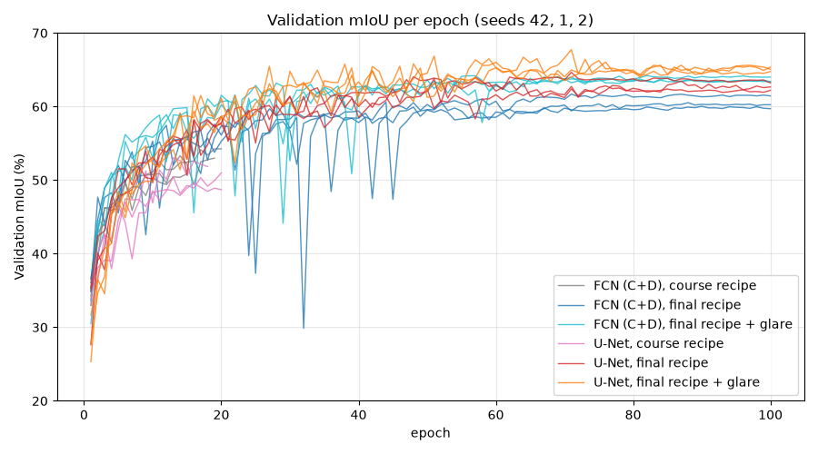
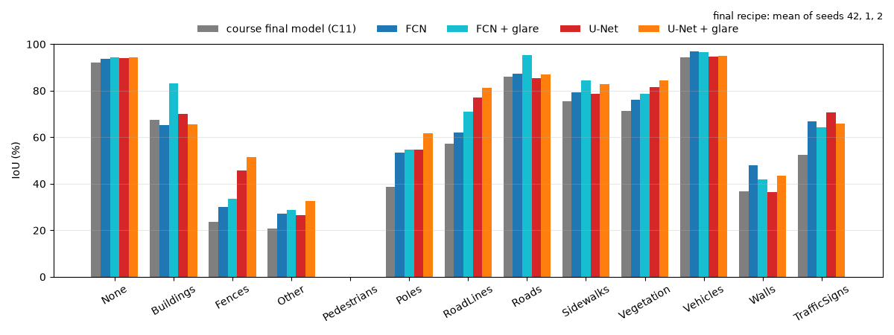

# Automotive Artificial Intelligence 2025 — 2D Semantic Segmentation from Scratch

**English** | [한국어](README_ko.md)

A three-person team project for the Automotive Artificial Intelligence course (Kookmin University, Fall 2025).<br>
Pixel-wise segmentation of CARLA driving scenes into 13 classes,<br>
with networks trained from scratch (no pretrained weights, no extra data).

| Item | Details |
|---|---|
| Course | Automotive Artificial Intelligence<br>Kookmin University College of Automotive Engineering · Fall 2025 |
| Team | **Team 1** — Chaeyeon&nbsp;Kim, Sihyeon&nbsp;Park, Hyojeong&nbsp;Oh |
| Task | 2D semantic segmentation · 13 classes · 800×600<br>CARLA (Lyft–Udacity) · 1000 train / 1000 validation images · no test set<br>pretrained models and extra data not allowed |
| Stack | PyTorch 2.9 · scratch FCN-ResNet50 and ResNet50-v1d backbones<br>one Windows laptop GPU (CUDA 12.8), Colab, a home PC |
| Presentation | 2025.12.01 |

### Results at a Glance

| Stage | mIoU (%) | Notes |
|---|:---:|---|
| Course (2025.11) | **55.11** | FCN on a ResNet50-v1d backbone<br>pixel accuracy 89.78 % · Pedestrians IoU 0 % |
| After the course (2026-10) | **63.58 ± 0.38** | same model, new training recipe + synthetic backlight augmentation<br>3 seeds, last epoch · Chaeyeon&nbsp;Kim |
| Ensemble | **67.96 ± 0.49** | with a U-Net trained the same way |

> There is no separate test set, so Validation was not used for training; it was used to select checkpoints and hyperparameters.<br>
> All reported numbers are on Validation.



7 Training and 7 Validation drives, no drive on both sides.<br>
Two Validation drives (F5, F7) face the sun for their whole length.

<details>
<summary><b>Project brief (as announced)</b></summary>

<br>

| Item | Details |
|---|---|
| Content | Design, training and evaluation of a 2D semantic segmentation model on the given dataset<br>no additional data, no pretrained models (using only part of the data is allowed)<br>presentation + code submission |
| Presentation | Slides in English (ppt / pdf) · talk in English or Korean<br>10 minutes + Q&A |
| Schedule | Slides due 11/28 11:59 pm (no edits afterwards)<br>presentations 12/1–2 in class |
| Dataset | CARLA-generated driving scenes with segmentation labels (Kaggle Lyft–Udacity challenge)<br>Training 1000, Validation 1000 (no test set) · 800×600 |

| Grading item | Points |
|---|:---:|
| 1. Creativity and logic of the model design | 30 |
| 2. Validity of the result analysis | 20 |
| 3. Model performance | 10 |
| 4. Slides and delivery | 20 |
| 5. Presentation time (about 10 minutes) | 10 |
| 6. Q&A | 10 |

</details>

---

## Workflow



---

## System

| Part | What it does |
|---|---|
| Data | 13-class CARLA labels read from the first PNG channel<br>training: 512×512 random crop · validation: full 800×600 frame |
| Imbalance | class weights 1/log(1.02 + pixel share), normalised to mean 1<br>images with Pedestrians, RoadLines or TrafficSigns: sampled 3×, augmented harder |
| Backbone | ResNet-50 written from scratch, dilation 2 in layer3 and 4 in layer4 (output stride 8)<br>v1d variant: 3×3 stem (ResNet-C) + AvgPool shortcut (ResNet-D) |
| Head | torchvision-style FCN head on layer4 + auxiliary head on layer3 (loss weight 0.4)<br>bilinear upsampling to the input size |
| Training | Adam 2e-4 · batch 4 · 20 epochs<br>ReduceLROnPlateau on validation pixel accuracy · early stop after 5 epochs without improvement |

**Why FCN rather than U-Net / U-Net++**

- Most teams were expected to use U-Net / U-Net++, and creativity of the model design was worth 30 points.
- The aim was to show how far an older, generally weaker architecture can go.
- U-Net needs 1.5–1.6× the GPU memory under the same settings.
- On the slides: U-Net 48.69, U-Net++ 44.73 (10 epochs) vs FCN-ResNet50 55.11.

---

## Results

### Course (2025.11)

| Model (all trained from scratch) | Pixel acc | mIoU |
|---|:---:|:---:|
| 3-block CNN baseline (11.15) | 82.95 | 43.85 |
| FCN-ResNet50, class-weighted CE (11.22) | 87.73 | 51.21 |
| + rare-image aug, ×3 oversampling, wider jitter + blur (11.25) | 90.17 | 54.04 |
| **FCN-ResNet50-v1d + ReduceLROnPlateau (11.27) — final** | **89.78** | **55.11** |
| Custom encoder–decoder "K-FCNConcat"<br>(Sihyeon&nbsp;Park, 11.25, no augmentation) | — | 51.61 |

- Every number is read from the notebook outputs in `experiments/`.
- All runs and per-class IoU: [results/](results/)
- Final model excluding Pedestrians: mIoU 59.70 %.



| Best image (pixel acc 96.75 %) | Worst image (63.75 %, back-lit) |
|:---:|:---:|
|  |  |

### After the Course (2026-10)

Same model as the course, retrained by Chaeyeon&nbsp;Kim.<br>
(FCN on the ResNet50-v1d backbone, in effect ResNet-C + D: [post-mortem §6](docs/postmortem.md#6-resnet-b-applied-backwards))

**New recipe**

- AdamW 5e-4, weight decay 1e-2
- cosine schedule with 1 warm-up epoch
- full 800×600 frames instead of 512 crops
- cross-entropy + 0.5 Dice
- 100 epochs, batch 4

| mIoU (%) | Course recipe | New recipe | + synthetic backlight |
|---|:---:|:---:|:---:|
| FCN-ResNet50-v1d | 52.64 ± 2.03 | 60.47 ± 0.89 | **63.58 ± 0.38** |
| U-Net (31.0 M parameters, no pretrained weights) | 50.87 ± 1.90 | 62.70 ± 0.51 | **65.06 ± 0.30** |
| Ensemble of the two (same seed) | | | **67.96 ± 0.49** |

- Mean ± standard deviation of seeds 42, 1 and 2 at the last epoch.
- Course recipe: checkpoint chosen by pixel accuracy, as in the course.
- Ensemble: equal-weight mean of the softmax outputs.

**Backlit drives**

- Two Validation drives, F5 and F7, face the sun for their whole length; no Training drive does.
- Without glare training they hold the 10 % worst frames of every model.<br>
  The glared wet road is predicted as Buildings.
- Synthetic glare on 30 % of the training images:<br>
  sepia, haze, glow near the horizon, wet road texture with puddle reflections.<br>
  It was tuned by comparing with F5 / F7 frames.
- FCN on F5 + F7: 36.67 → **50.56**<br>
  other five drives unchanged: 67.13 → 66.86


**FCN vs U-Net**

- FCN holds up better on the backlit drives and relies more on the rest of the frame.
- U-Net is stronger on thin structures (RoadLines 98.0 vs 74.2 on the other drives).
- They fail in different places, so their ensemble is above both.

**Pedestrians** stay at 0 % IoU: the 292 pedestrian blobs in Validation have a median area of 3 pixels.

<details>
<summary><b>More figures</b> (mIoU per epoch, per-class IoU)</summary>

<br>





</details>

- Steps, runs and what did not help: [docs/postmortem.md](docs/postmortem.md#after-the-course-2026-10)
- Models: [GitHub release](https://github.com/ChaeYeonKim0204/Automotive-Artificial-Intelligence/releases)

---

## Team

|  |  |  |
|:---:|:---:|:---:|
| **Chaeyeon&nbsp;Kim**<br/>[@ChaeYeonKim0204](https://github.com/ChaeYeonKim0204) | **Sihyeon&nbsp;Park**<br/>[@kha-2](https://github.com/kha-2) | **Hyojeong&nbsp;Oh**<br/>[@ohhyojeong](https://github.com/ohhyojeong) |
| Scratch FCN-ResNet50 and ResNet50-v1d<br/>EDA, class imbalance, evaluation<br/>All FCN-line training runs | Segmentation theory (FCN, U-Net, ResNet)<br/>Custom encoder–decoder (K-FCNConcat)<br/>Augmentation, slides assembly and submission | Segmentation theory, U-Net line<br/>Colab port of the FCN<br/>Limitations slides, reference QA |

---

## Contributions

### Participation by Area

◎ led · ○ actively contributed · △ took part

| Area | **Chaeyeon&nbsp;Kim** | **Sihyeon&nbsp;Park** | **Hyojeong&nbsp;Oh** |
|---|:---:|:---:|:---:|
| Team operations and schedule | ◎ | ◎ | ○ |
| Environment and compute | ◎ | △ | △ |
| Data analysis (EDA) and class imbalance | ◎ |  |  |
| FCN-ResNet50 / ResNet50-v1d line | ◎ | △ | ○ |
| Custom encoder–decoder (K-FCNConcat) | △ | ◎ |  |
| U-Net / U-Net++ comparison (slides only) | | ◎ | ◎ |
| Augmentation | ○ | ◎ | △ |
| Evaluation code and result analysis | ◎ | ○ | △ |
| Post-course experiments (2026-10) | ◎ | | |
| Segmentation theory study (FCN, U-Net, ResNet) | △ | ◎ | ◎ |
| Colab FCN line, class-ratio augmentation | | | ◎ |
| Slides, references and presentation | ◎ | ◎ | ◎ |

### Highlights by Member

**Chaeyeon&nbsp;Kim** · [@ChaeYeonKim0204](https://github.com/ChaeYeonKim0204)

- Baseline CNN (11.15) and the **scratch FCN-ResNet50** with EDA-derived class weights (11.20‑21)
- Found that the 75 % came from the training split; moved evaluation to the real validation set (11.22)
- Rare-image augmentation, oversampling, mIoU-based selection → 54.0 (11.23‑25)
- **ResNet50-v1d backbone + plateau scheduler → final 55.1** (11.27)
- Every FCN-line run on one laptop; EDA and FCN-ResNet slides
- After the course (2026-10): recipe search → 60.47<br>
  backlit drives found and covered with synthetic glare → **63.58** · ensemble with U-Net 67.96

**Sihyeon&nbsp;Park** · [@kha-2](https://github.com/kha-2)

- **Segmentation theory for the team**: FCN, U-Net, transposed convolution, ResNet notes (11.19‑28)
- Augmentation plan and albumentations script (11.21)
- **Custom encoder–decoder `khaha` / K-FCNConcat** → 49.5 / 52.2, then 51.6 with BatchNorm + Dice (11.22–25)
- Visualisation and per-class IoU code; U-Net / U-Net++ comparison for the slides
- Part split, slide assembly, final PDF submission (11.28)

**Hyojeong&nbsp;Oh** · [@ohhyojeong](https://github.com/ohhyojeong)

- **Segmentation and U-Net theory**; U-Net slides
- Colab FCN-ResNet50 line:<br>
  port with class weights (11.22), class-ratio-driven augmentation (11.25), mIoU evaluation fix (11.26)
- Limitations slides, reference and formatting QA (11.28)

Who did what and when: [docs/contributions.md](docs/contributions.md)

---

## Chronicle

Main steps (mIoU %). Full table: [docs/contributions.md](docs/contributions.md#who-did-what-when)

| Date | Member | Work | Result |
|---|---|---|---|
| 11.15 | Chaeyeon&nbsp;Kim | 3-block CNN baseline | 43.85 |
| 11.20‑21 | Chaeyeon&nbsp;Kim | Scratch FCN-ResNet50, class weights | 75.0<br>(train-split estimate) |
| 11.22 | Chaeyeon&nbsp;Kim | Evaluation on the real validation set | 51.21 |
| 11.22‑25 | Sihyeon&nbsp;Park | Custom encoder–decoder `khaha`<br>10 → 20 epochs, BatchNorm + Dice | 49.45 → 52.16 → 51.61 |
| 11.22‑26 | Hyojeong&nbsp;Oh | Colab FCN: port, class-ratio augmentation,<br>mIoU evaluation fix | Colab FCN line closed |
| 11.25 | Chaeyeon&nbsp;Kim | Enhanced augmentation (wider jitter, blur) | 54.04 |
| 11.27 | Chaeyeon&nbsp;Kim | ResNet50-v1d backbone, scheduler | **55.11** |
| 11.28 | Sihyeon&nbsp;Park | U-Net / U-Net++ comparison, slide assembly | **PDF submitted** |
| 11.28 | Hyojeong&nbsp;Oh | Bottleneck slide, reference QA | Submission-ready |
| 12.01 | All | Script and Q&A preparation, presentation | Presentation done |
| 2026.10.11‑15 | Chaeyeon&nbsp;Kim | Recipe search, full frame, Dice, 100 epochs,<br>temporal checks, U-Net comparison | 60.47 (3 seeds) |
| 2026.10.16‑17 | Chaeyeon&nbsp;Kim | Backlit drives F5 / F7, synthetic glare,<br>glare U-Net, ensembles | **63.58**<br>ensemble 67.96 |

---

## Key Problems

| Problem | Cause | What we did |
|---|---|---|
| mIoU 75 % that was not real | Validation taken as a random 200-image split of the Training folder<br>neighbouring frames of one drive on both sides | Evaluated the Validation folder (different drives)<br>→ 51 % |
| Pedestrians IoU 0 %<br>in every model | 0.006 % of pixels<br>the "rare" set also had RoadLines and TrafficSigns (in 95–97 % of images),<br>so oversampling touched almost every image | Class weights and rare-image augmentation<br>no pedestrian-specific crop or loss in time |
| Validation accuracy swinging<br>10–20 points between epochs | 1000 images, fixed Adam 2e-4<br>validation loss 2.2–2.5 while train loss stays near 0.2 | ReduceLROnPlateau: 51.16 → 55.11 on v1d (14 vs 20 epochs confounded)<br>no gain on the plain FCN (54.04 → 53.61, selection metric also changed) |
| Custom model collapsing to 3.7 %<br>with augmentation | Not found in time | Reported K-FCNConcat numbers come from runs without augmentation |
| Colab runs short or failing | 4-D label tensors, CPU runtimes | FCN-line runs on one laptop |
| ResNet-B applied backwards | The tweak description used while coding<br>had the stride on the wrong conv | Kept as trained<br>final backbone is in effect ResNet-C + D |
| Worst images back-lit (63.75 %) | F5 and F7 face the sun for their whole length<br>no Training drive does | After the course: synthetic glare on 30 % of training images<br>F5 + F7 36.67 → 50.56 |

---

## Post-mortem

**What held us back**

- two weeks, one GPU laptop for every FCN-line run
- an early mIoU of 75 % from a random split of the training sequences
- pedestrians at 0.006 % of the pixels

**Caveats**

- Single seed, so differences under about 1 point are within noise<br>
  (v1d vs FCN on basic augmentation: +0.2)
- The scheduler gain is confounded with 14 vs 20 epochs.
- Checkpoint selection and reporting share the Validation set (no test set).

**What moved the number**

- switching to the validation set
- class-weighted loss with rare-image augmentation and oversampling
- a ResNet50-v1d backbone with a plateau scheduler

**After the course (2026-10)**: same model, 3-seed mean of the last 5 epochs, 51.95 → 60.52

| Change | mIoU gain |
|---|:---:|
| Cosine schedule, 30 epochs, no early stop | +1.8 |
| AdamW 5e-4 | +2.0 |
| Full frames | +1.2 |
| 60 epochs | +1.8 |
| Dice + 100 epochs | +1.7 |

- The largest remaining error source was a condition missing from Training: the backlit drives F5 / F7.<br>
  Synthetic glare raised them by 13.9 and the whole Validation set to 63.58.
- Did not help: temporal inputs and heads, scale augmentation, multi-scale TTA.
- An ensemble with a U-Net trained the same way reached 67.96.

**If pedestrians had reached even 20 % IoU** *(estimate)*

- mIoU about 56.6 instead of 55.11, since one class is 1/13 of the mean.
- The levers were known: pedestrian-centred crops, a larger weight or a Dice / focal term, a true rare-image sampler.
- The two-week window went to the backbone and the slides.

Full analysis, experiment log and lessons: [docs/postmortem.md](docs/postmortem.md)

---

## Quick Start

```bash
pip install -r requirements.txt
# dataset (course-provided, not included):
#   <root>/Training/{RGB,Label}
#   <root>/Validation/{RGB,Label}
cd src
```

Course recipe:

```bash
python -m autoseg.train --data-root "/path/2D Segmentation" \
    --model fcn_resnet50_v1d --aug enhanced --scheduler --epochs 20 \
    --out ../models/fcn_resnet50_v1d.pt

python -m autoseg.evaluate --data-root "/path/2D Segmentation" \
    --model fcn_resnet50_v1d --ckpt ../models/fcn_resnet50_v1d.pt \
    --figures ../results/figures
```

Recipe after the course (about 1 h 50 min on an RTX 4070 Ti):

```bash
python -m autoseg.train --data-root "/path/2D Segmentation" --cache-dir /path/cache \
    --model fcn_resnet50_v1d --aug enhanced \
    --optimizer adamw --lr 5e-4 --weight-decay 1e-2 --lr-schedule cosine --warmup-epochs 1 \
    --crop 0 --dice-weight 0.5 --glare 0.3 --epochs 100 \
    --select miou --patience 1000 --amp --seed 42 \
    --out ../models/fcn_glare_s42.pt
```

Released models ([GitHub release](https://github.com/ChaeYeonKim0204/Automotive-Artificial-Intelligence/releases)):

```bash
# glare FCN alone: 64.01
python -m autoseg.evaluate --data-root "/path/2D Segmentation" --amp \
    --model fcn_resnet50_v1d --ckpt fcn_resnet50_v1d_glare_seed42.pt

# glare FCN + glare U-Net: 68.49
python -m autoseg.ensemble --data-root "/path/2D Segmentation" --amp \
    --member F=fcn_resnet50_v1d:fcn_resnet50_v1d_glare_seed42.pt \
    --member U=unet:unet_glare_seed42.pt --combo F+U
```

- More commands (analysis, calibration, glare check, context check, temporal head, U-Net):<br>
  [experiments/postcourse/](experiments/postcourse/README.md)
- `python -m autoseg.smoke_test` checks output shapes and the IoU metric.

<details>
<summary><b>Reproduction check</b> (2026-10, RTX 4070 Ti)</summary>

<br>

`src/autoseg` is the final notebook refactored into modules (dataset, two backbones, training loop, evaluation).

| Run | Pixel acc | mIoU |
|---|:---:|:---:|
| `evaluate` on the original checkpoint | 89.78 | 55.11 (exact) |
| `train` re-run, torch 2.14, accuracy selection (best epoch 13) | 87.37 | 51.90 |
| `train` re-run, torch 2.9.1, accuracy selection (best epoch 11) | 89.46 | 51.80 |
| `train` re-run, torch 2.9.1, `--select miou` (epoch 17) | 89.53 | **54.87** |

- The two accuracy-selected re-runs stopped early; in the torch 2.9.1 run mIoU peaked at 53.57 in epoch 14.
- `--select miou` is cheap now that the confusion matrix is vectorised; it came within 0.3 points of the course run.
- Logs in [results/](results/). The best / middle / worst figures in `results/figures/` come from the notebook.
- The original checkpoint (142 MB) is attached to the GitHub release.

</details>

---

## Repository

- `src/autoseg/`: final model as a package
  - data, models (`fcn_resnet50`, `fcn_resnet50_v1d`, plus `unet` and a temporal head added after the course)
  - engine, train / evaluate / analyze / calibrate / ensemble CLIs, synthetic glare augmentation
- `experiments/`: the notebooks as they were run, by member and date (outputs kept)
  - `experiments/postcourse/`: commands and check scripts of the 2026-10 runs
- `results/`: experiment tables, per-class IoU, backlit vs other drives, figures
- `slides/`: final presentation PDF (2025.12.01)
- `docs/`: timeline, contributions, post-mortem, repository guide

## Docs

- [docs/contributions.md](docs/contributions.md): each member's work with dates
- [docs/postmortem.md](docs/postmortem.md): root causes, model evolution, experiment log, lessons
- [docs/timeline.md](docs/timeline.md): course, project and presentation days
- [docs/repository.md](docs/repository.md): folder tree, how the team worked, notebook index, third-party sources
