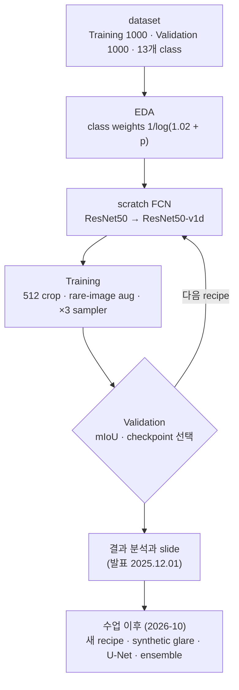

# 자동차인공지능 2025 — pretrained 없이 직접 만든 2D semantic segmentation

[English](README.md) | **한국어**

자동차인공지능 수업(국민대학교, 2025년 가을학기) 세 명의 팀 프로젝트.<br>
CARLA 주행 장면의 pixel을 13개 class로 분류,<br>
scratch 학습(pretrained weights·추가 데이터 없음).

| 항목 | 내용 |
|---|---|
| 과목 | 자동차인공지능<br>국민대학교 자동차융합대학 · 2025년 가을학기 |
| 팀 | **1조** — <nobr>김채연</nobr>, <nobr>박시현</nobr>, <nobr>오효정</nobr> |
| 과제 | 2D semantic segmentation · 13개 class · 800×600<br>CARLA(Lyft–Udacity) · 학습 1000장 / validation 1000장 · test set 없음<br>pretrained 모델·추가 데이터 사용 금지 |
| Stack | PyTorch 2.9 · scratch FCN-ResNet50 및 ResNet50-v1d backbone<br>Windows laptop GPU 한 대(CUDA 12.8), Colab, 개인 PC |
| 발표 | 2025.12.01 |

### 결과 한눈에 보기

| 단계 | mIoU (%) | 비고 |
|---|:---:|---|
| 수업 (2025.11) | **55.11** | ResNet50-v1d backbone의 FCN<br>pixel accuracy 89.78 % · Pedestrians IoU 0 % |
| 수업 이후 (2026-10) | **63.58 ± 0.38** | 동일 모델, 새 training recipe + synthetic backlight augmentation<br>3 seeds, last epoch · <nobr>김채연</nobr> |
| ensemble | **67.96 ± 0.49** | 동일하게 학습한 U-Net과 ensemble |

> 별도 test set이 제공되지 않아, Validation set은 학습에는 사용하지 않고 checkpoint와 hyperparameter 선택에 사용했다.<br>
> 보고한 수치는 모두 Validation 기준이다.


Training 7개, Validation 7개 주행이며 양쪽에 모두 포함된 주행은 없음.<br>
Validation 주행 중 두 개(F5, F7)는 전체 구간에서 정면으로 해를 마주함.

<details>
<summary><b>과제 안내 (공지 기준)</b></summary>

<br>

| 항목 | 내용 |
|---|---|
| 내용 | 주어진 dataset으로 2D semantic segmentation 모델 설계·학습·평가<br>추가 데이터·pretrained 모델 사용 금지(데이터 일부만 사용 가능)<br>발표 + 코드 제출 |
| 발표 조건 | 발표자료는 영어(ppt / pdf) · 발표는 영어 또는 한국어<br>10분 + Q&A |
| 일정 | 발표자료 마감 11/28 오후 11:59(이후 수정 불가)<br>수업 중 발표 12/1–2 |
| dataset | CARLA로 생성한 주행 장면과 segmentation label(Kaggle Lyft–Udacity challenge)<br>Training 1000장, Validation 1000장(test set 없음) · 800×600 |

| 평가 항목 | 배점 |
|---|:---:|
| 1. 모델 설계의 창의성·논리성 | 30 |
| 2. 결과 분석의 타당성 | 20 |
| 3. 모델 성능 | 10 |
| 4. 발표자료·전달력 | 20 |
| 5. 발표 시간(약 10분) | 10 |
| 6. Q&A | 10 |

</details>

---

## 워크플로우



---

## 시스템

| 구성 | 역할 |
|---|---|
| 데이터 | PNG 첫 channel에서 13개 class CARLA label 읽음<br>학습: 512×512 random crop · validation: 800×600 전체 frame |
| class imbalance | class weights 1/log(1.02 + pixel 비율), 평균 1로 normalize<br>Pedestrians, RoadLines, TrafficSigns 포함 이미지: 3× sampling, 더 강한 augmentation |
| backbone | ResNet-50 직접 구현, layer3 dilation 2·layer4 dilation 4(output stride 8)<br>v1d 변형: 3×3 stem(ResNet-C) + AvgPool shortcut(ResNet-D) |
| head | layer4에 torchvision 방식 FCN head + layer3에 aux head(loss weight 0.4)<br>입력 크기로 bilinear upsampling |
| Training | Adam 2e-4 · batch 4 · 20 epochs<br>validation pixel accuracy 기준 ReduceLROnPlateau · 5 epochs 개선 없으면 early stop |

**U-Net / U-Net++ 대신 FCN을 선택한 이유**

- 대부분의 팀이 U-Net / U-Net++를 사용할 것으로 예상했고, 모델 설계 창의성 배점은 30점.
- 일반적으로 성능이 낮은 오래된 구조로 어디까지 갈 수 있는지 보여주는 것이 목표.
- 동일 설정에서 U-Net은 GPU memory 1.5–1.6× 필요.
- slide 결과: U-Net 48.69, U-Net++ 44.73(10 epochs) vs FCN-ResNet50 55.11.

---

## 결과

### 수업 (2025.11)

| 모델(전부 scratch 학습) | pixel acc | mIoU |
|---|:---:|:---:|
| 3-block CNN baseline (11.15) | 82.95 | 43.85 |
| FCN-ResNet50, class-weighted CE (11.22) | 87.73 | 51.21 |
| + rare-image aug, ×3 oversampling, jitter 범위 확대 + blur (11.25) | 90.17 | 54.04 |
| **FCN-ResNet50-v1d + ReduceLROnPlateau (11.27) — 최종** | **89.78** | **55.11** |
| 자체 encoder–decoder "K-FCNConcat"<br>(<nobr>박시현</nobr>, 11.25, augmentation 없음) | — | 51.61 |

- 모든 수치는 `experiments/` notebook 출력에서 확인.
- 전체 실행과 per-class IoU: [results/](results/)
- 최종 모델에서 Pedestrians 제외 시 mIoU 59.70 %.


| 최고 이미지 (pixel acc 96.75 %) | 최저 이미지 (63.75 %, 역광) |
|:---:|:---:|
|  |  |

### 수업 이후 (2026-10)

수업과 동일한 모델을 <nobr>김채연</nobr>이 재학습.<br>
(ResNet50-v1d backbone의 FCN, 사실상 ResNet-C + D: [post-mortem §6](docs/postmortem_ko.md#6-resnet-b-반대로-적용))

**새 recipe**

- AdamW 5e-4, weight decay 1e-2
- warm-up 1 epoch의 cosine schedule
- 512 crop 대신 800×600 전체 frame
- cross-entropy + 0.5 Dice
- 100 epochs, batch 4

| mIoU (%) | 수업 recipe | 새 recipe | + synthetic backlight |
|---|:---:|:---:|:---:|
| FCN-ResNet50-v1d | 52.64 ± 2.03 | 60.47 ± 0.89 | **63.58 ± 0.38** |
| U-Net(31.0 M parameters, pretrained weights 없음) | 50.87 ± 1.90 | 62.70 ± 0.51 | **65.06 ± 0.30** |
| 두 모델의 ensemble(같은 seed) | | | **67.96 ± 0.49** |

- seeds 42, 1, 2의 last epoch 평균 ± 표준편차.
- 수업 recipe: 수업과 동일하게 pixel accuracy 기준 checkpoint 선택.
- ensemble: softmax 출력의 동일 가중치 평균.

**역광 주행**

- Validation 주행 중 F5와 F7은 처음부터 끝까지 정면 역광이며 Training에는 같은 조건의 주행이 없음.
- glare 학습 전에는 모든 모델의 하위 10 % frame이 모두 이 두 주행에 속함.<br>
  glare가 비친 젖은 도로를 Buildings로 예측.
- Training 이미지 30 %에 synthetic glare 적용:<br>
  sepia, haze, 수평선 근처 glow, 물웅덩이 반사가 있는 젖은 도로 texture.<br>
  F5 / F7 frame과 비교해 조정.
- FCN의 F5 + F7 성능: 36.67 → **50.56**<br>
  나머지 다섯 주행은 유지: 67.13 → 66.86


**FCN vs U-Net**

- FCN은 역광 주행에서 더 강하고 frame의 나머지 영역에 더 의존.
- U-Net은 얇은 구조에서 우세(나머지 주행 RoadLines 98.0 vs 74.2).
- 실패 지점이 달라 ensemble이 두 모델보다 높음.

**Pedestrians** IoU는 계속 0 %: Validation의 pedestrian blob 292개는 median area 3 pixels.

<details>
<summary><b>추가 그림</b> (epoch별 mIoU, per-class IoU)</summary>

<br>


</details>

- 단계, 실행, 효과 없었던 항목: [docs/postmortem_ko.md](docs/postmortem_ko.md#수업-이후-2026-10)
- 모델: [GitHub release](https://github.com/ChaeYeonKim0204/Automotive-Artificial-Intelligence/releases)

---

## 팀

|  |  |  |
|:---:|:---:|:---:|
| **<nobr>김채연</nobr>**<br/>[@ChaeYeonKim0204](https://github.com/ChaeYeonKim0204) | **<nobr>박시현</nobr>**<br/>[@kha-2](https://github.com/kha-2) | **<nobr>오효정</nobr>**<br/>[@ohhyojeong](https://github.com/ohhyojeong) |
| scratch FCN-ResNet50·ResNet50-v1d<br/>EDA, class imbalance, 평가<br/>모든 FCN 계열 학습 수행 | segmentation 이론(FCN, U-Net, ResNet)<br/>자체 encoder–decoder(K-FCNConcat)<br/>augmentation, slide 취합·제출 | segmentation 이론, U-Net 계열<br/>FCN Colab port<br/>Limitations slide, 참고문헌 QA |

---

## 기여

### 영역별 참여도

◎ 주도 · ○ 적극 기여 · △ 참여

| 영역 | **<nobr>김채연</nobr>** | **<nobr>박시현</nobr>** | **<nobr>오효정</nobr>** |
|---|:---:|:---:|:---:|
| 팀 운영·일정 | ◎ | ◎ | ○ |
| 환경·연산 자원 | ◎ | △ | △ |
| 데이터 분석(EDA)·class imbalance | ◎ |  |  |
| FCN-ResNet50 / ResNet50-v1d 계열 | ◎ | △ | ○ |
| 자체 encoder–decoder(K-FCNConcat) | △ | ◎ |  |
| U-Net / U-Net++ 비교(slide에만 기록) | | ◎ | ◎ |
| augmentation | ○ | ◎ | △ |
| 평가 코드·결과 분석 | ◎ | ○ | △ |
| 수업 이후 실험 (2026-10) | ◎ | | |
| segmentation 이론 공부(FCN, U-Net, ResNet) | △ | ◎ | ◎ |
| Colab FCN 계열, class 비율 기반 augmentation | | | ◎ |
| slide·참고문헌·발표 | ◎ | ◎ | ◎ |

### 멤버별 주요 작업

**<nobr>김채연</nobr>** · [@ChaeYeonKim0204](https://github.com/ChaeYeonKim0204)

- baseline CNN(11.15), EDA 기반 class weights 적용 **scratch FCN-ResNet50**(11.20‑21)
- 75 %가 training split 평가치임을 발견, 실제 validation set으로 평가 전환(11.22)
- rare-image augmentation, oversampling, mIoU 기준 선택 → 54.0(11.23‑25)
- **ResNet50-v1d backbone + plateau scheduler → 최종 55.1**(11.27)
- 모든 FCN 계열 실행을 laptop 한 대에서 수행 · EDA·FCN-ResNet slide
- 수업 이후(2026-10): recipe 탐색 → 60.47<br>
  역광 주행 발견 및 synthetic glare 적용 → **63.58** · U-Net과 ensemble 67.96

**<nobr>박시현</nobr>** · [@kha-2](https://github.com/kha-2)

- **팀 내 segmentation 이론 정리**: FCN, U-Net, transposed convolution, ResNet(11.19‑28)
- augmentation 계획·albumentations script(11.21)
- **자체 encoder–decoder `khaha` / K-FCNConcat** → 49.5 / 52.2, 이후 BatchNorm + Dice 적용으로 51.6(11.22–25)
- 시각화·per-class IoU 코드, slide용 U-Net / U-Net++ 비교
- 파트 분담, slide 취합, 최종 PDF 제출(11.28)

**<nobr>오효정</nobr>** · [@ohhyojeong](https://github.com/ohhyojeong)

- **segmentation·U-Net 이론** · U-Net slide
- Colab FCN-ResNet50 계열:<br>
  class weights 적용 port(11.22), class 비율 기반 augmentation(11.25), mIoU 평가 수정(11.26)
- Limitations slide, 참고문헌·서식 QA(11.28)

날짜별 담당 작업: [docs/contributions_ko.md](docs/contributions_ko.md)

---

## 연대기

주요 단계(mIoU %). 전체 표: [docs/contributions_ko.md](docs/contributions_ko.md#날짜별-담당-업무)

| 날짜 | 멤버 | 작업 | 결과 |
|---|---|---|---|
| 11.15 | <nobr>김채연</nobr> | 3-block CNN baseline | 43.85 |
| 11.20‑21 | <nobr>김채연</nobr> | scratch FCN-ResNet50, class weights | 75.0<br>(train split 평가치) |
| 11.22 | <nobr>김채연</nobr> | 실제 validation set으로 평가 | 51.21 |
| 11.22‑25 | <nobr>박시현</nobr> | 자체 encoder–decoder `khaha`<br>10 → 20 epochs, BatchNorm + Dice | 49.45 → 52.16 → 51.61 |
| 11.22‑26 | <nobr>오효정</nobr> | Colab FCN: port, class 비율 기반 augmentation,<br>mIoU 평가 수정 | Colab FCN 계열 작업 종료 |
| 11.25 | <nobr>김채연</nobr> | 강화 augmentation(jitter 범위 확대, blur) | 54.04 |
| 11.27 | <nobr>김채연</nobr> | ResNet50-v1d backbone, scheduler | **55.11** |
| 11.28 | <nobr>박시현</nobr> | U-Net / U-Net++ 비교, slide 취합 | **PDF 제출** |
| 11.28 | <nobr>오효정</nobr> | bottleneck slide, 참고문헌 QA | 제출 준비 완료 |
| 12.01 | 팀 전원 | 발표 대본·Q&A 준비, 발표 | 발표 완료 |
| 2026.10.11‑15 | <nobr>김채연</nobr> | recipe 탐색, 전체 frame, Dice, 100 epochs,<br>temporal 검증, U-Net 비교 | 60.47(3 seeds) |
| 2026.10.16‑17 | <nobr>김채연</nobr> | 역광 주행 F5 / F7, synthetic glare,<br>glare U-Net, ensemble | **63.58**<br>ensemble 67.96 |

---

## 주요 문제

| 문제 | 원인 | 대응 |
|---|---|---|
| 부풀려진 mIoU 75 % | Training 폴더에서 200장을 random split하여 Validation으로 사용<br>동일 주행의 인접 frame이 양쪽에 배치됨 | 다른 주행의 Validation 폴더 평가<br>→ 51 % |
| Pedestrians IoU 0 %<br>모든 모델에서 발생 | pixel의 0.006 %<br>"rare" 집합에 이미지 95–97 %에 나오는 RoadLines·TrafficSigns도 포함돼<br>oversampling이 거의 모든 이미지에 적용됨 | class weights와 rare-image augmentation<br>마감 전 보행자 전용 crop·loss 미적용 |
| epoch마다 Validation accuracy<br>10–20포인트 변동 | 이미지 1000장, Adam 2e-4 고정<br>학습 loss는 0.2 부근이나 validation loss는 2.2–2.5 | ReduceLROnPlateau: v1d에서 51.16 → 55.11(14 vs 20 epochs 효과와 혼재)<br>일반 FCN은 개선 없음(54.04 → 53.61, 선택 지표도 변경됨) |
| 자체 모델이 3.7 %로 붕괴<br>augmentation 적용 시 | 마감 전 원인 미발견 | 보고된 K-FCNConcat 수치는 augmentation 없는 실행 결과 |
| Colab 실행 실패·정체 | 4-D label tensor, CPU runtime | FCN 계열 실행을 laptop 한 대에서 수행 |
| ResNet-B 반대로 적용 | 코딩 시 참고한 구조 변경 설명에서<br>stride가 잘못된 conv에 있었음 | 학습된 그대로 유지<br>최종 backbone은 사실상 ResNet-C + D |
| 최저 성능 이미지가 역광(63.75 %) | F5와 F7은 처음부터 끝까지 정면 역광<br>Training에는 같은 조건의 주행이 없음 | 수업 이후: Training 이미지 30 %에 synthetic glare 적용<br>F5 + F7 36.67 → 50.56 |

---

## 회고

**제약**

- 두 주, 모든 FCN 계열 실행에 GPU laptop 한 대 사용
- training 주행의 random split에서 나온 초기 mIoU 75 %
- 전체 pixel의 0.006 %뿐인 보행자

**해석 시 유의점**

- 단일 seed로 실행하여 약 1포인트 미만 차이는 변동 범위 내<br>
  (기본 augmentation의 v1d vs FCN: +0.2)
- scheduler 개선 효과는 14 vs 20 epochs 차이와 혼재.
- checkpoint 선택과 결과 보고에 동일한 Validation set 사용(test set 없음).

**성능 개선 요인**

- Validation set 평가로 전환
- class-weighted loss + rare-image augmentation·oversampling
- ResNet50-v1d backbone + plateau scheduler

**수업 이후 (2026-10)**: 동일 모델, last 5 epochs의 3-seed 평균, 51.95 → 60.52

| 변경 | mIoU 개선 |
|---|:---:|
| cosine schedule, 30 epochs, early stop 없음 | +1.8 |
| AdamW 5e-4 | +2.0 |
| 전체 frame | +1.2 |
| 60 epochs | +1.8 |
| Dice + 100 epochs | +1.7 |

- 남은 가장 큰 오류 원인은 Training에 없는 조건인 역광 주행 F5 / F7.<br>
  synthetic glare로 두 주행 +13.9, 전체 Validation 63.58.
- 효과 없음: temporal input·head, scale augmentation, multi-scale TTA.
- 동일하게 학습한 U-Net과 ensemble 시 67.96.

**보행자 IoU가 20 %만 됐어도** *(추정)*

- mIoU 55.11 대신 약 56.6, class 하나가 평균의 1/13.
- 개선 방법은 알고 있었음: 보행자 중심 crop, 더 높은 weight 또는 Dice / focal 항, 실제 rare-image sampler.
- 두 주를 backbone 개선과 slide 작성에 소진.

전체 분석, 실험 기록, 교훈: [docs/postmortem_ko.md](docs/postmortem_ko.md)

---

## 빠른 시작

```bash
pip install -r requirements.txt
# dataset (수업 제공, 미포함):
#   <root>/Training/{RGB,Label}
#   <root>/Validation/{RGB,Label}
cd src
```

수업 recipe:

```bash
python -m autoseg.train --data-root "/path/2D Segmentation" \
    --model fcn_resnet50_v1d --aug enhanced --scheduler --epochs 20 \
    --out ../models/fcn_resnet50_v1d.pt

python -m autoseg.evaluate --data-root "/path/2D Segmentation" \
    --model fcn_resnet50_v1d --ckpt ../models/fcn_resnet50_v1d.pt \
    --figures ../results/figures
```

수업 이후 recipe(RTX 4070 Ti에서 약 1시간 50분):

```bash
python -m autoseg.train --data-root "/path/2D Segmentation" --cache-dir /path/cache \
    --model fcn_resnet50_v1d --aug enhanced \
    --optimizer adamw --lr 5e-4 --weight-decay 1e-2 --lr-schedule cosine --warmup-epochs 1 \
    --crop 0 --dice-weight 0.5 --glare 0.3 --epochs 100 \
    --select miou --patience 1000 --amp --seed 42 \
    --out ../models/fcn_glare_s42.pt
```

release 모델([GitHub release](https://github.com/ChaeYeonKim0204/Automotive-Artificial-Intelligence/releases)):

```bash
# glare FCN 단독: 64.01
python -m autoseg.evaluate --data-root "/path/2D Segmentation" --amp \
    --model fcn_resnet50_v1d --ckpt fcn_resnet50_v1d_glare_seed42.pt

# glare FCN + glare U-Net: 68.49
python -m autoseg.ensemble --data-root "/path/2D Segmentation" --amp \
    --member F=fcn_resnet50_v1d:fcn_resnet50_v1d_glare_seed42.pt \
    --member U=unet:unet_glare_seed42.pt --combo F+U
```

- 추가 명령(분석, calibration, glare 검증, context 검증, temporal head, U-Net):<br>
  [experiments/postcourse/](experiments/postcourse/README.md)
- `python -m autoseg.smoke_test`로 출력 shape와 IoU metric 확인.

<details>
<summary><b>재현 검증</b> (2026-10, RTX 4070 Ti)</summary>

<br>

`src/autoseg`는 최종 notebook을 모듈(dataset, 두 backbone, training loop, 평가)로 refactoring한 것.

| 실행 | pixel acc | mIoU |
|---|:---:|:---:|
| 원본 checkpoint를 `evaluate`로 평가 | 89.78 | 55.11 (정확히 재현) |
| `train` 재실행, torch 2.14, accuracy 기준 선택(best epoch 13) | 87.37 | 51.90 |
| `train` 재실행, torch 2.9.1, accuracy 기준 선택(best epoch 11) | 89.46 | 51.80 |
| `train` 재실행, torch 2.9.1, `--select miou` (epoch 17) | 89.53 | **54.87** |

- accuracy 기준 재실행 두 번은 모두 early stop · torch 2.9.1 실행에서 mIoU는 epoch 14에서 53.57로 최고.
- confusion matrix를 vectorize해 `--select miou` 계산 비용이 작아졌고, 수업 당시 실행과 0.3점 차이.
- 로그는 [results/](results/) · `results/figures/`의 best / middle / worst 그림은 notebook 산출물.
- 원본 checkpoint(142 MB)는 GitHub release에 첨부.

</details>

---

## 저장소 구성

- `src/autoseg/`: 패키지 형태의 최종 모델
  - data, models(`fcn_resnet50`, `fcn_resnet50_v1d`, 수업 이후 추가한 `unet`·temporal head)
  - engine, train / evaluate / analyze / calibrate / ensemble CLI, synthetic glare augmentation
- `experiments/`: 실행 당시 그대로의 notebook, 멤버·날짜별(출력 유지)
  - `experiments/postcourse/`: 2026-10 실행 명령과 검증 script
- `results/`: 실험 표, per-class IoU, 역광과 나머지 주행 비교, 그림
- `slides/`: 최종 발표 PDF(2025.12.01)
- `docs/`: 연대기, 기여, 회고, 저장소 안내

## 문서

- [docs/contributions_ko.md](docs/contributions_ko.md): 멤버별 작업과 날짜
- [docs/postmortem_ko.md](docs/postmortem_ko.md): 근본 원인, 모델 변천, 실험 기록, 교훈
- [docs/timeline_ko.md](docs/timeline_ko.md): 수업, 프로젝트, 발표 일정
- [docs/repository_ko.md](docs/repository_ko.md): 폴더 트리, 팀 작업 방식, notebook 목록, 외부 출처
