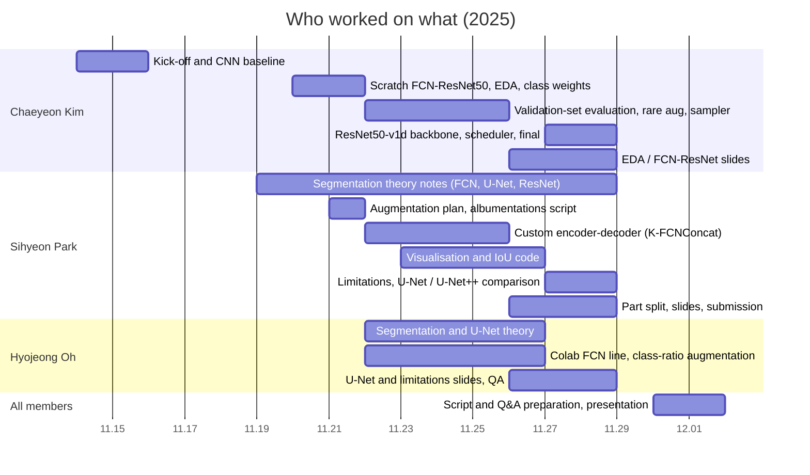

# Team Contributions

[← README](../README.md) · **English** | [한국어](contributions_ko.md)

## At a Glance

After the course (2026-10-11 → 17), Chaeyeon&nbsp;Kim alone: 
`src/autoseg` refactor and re-runs, recipe search, temporal checks, decision bias, U-Net comparison, 
backlit drives and synthetic glare, ensembles ([post-mortem](postmortem.md#after-the-course-2026-10)).

| Member | Role | Main deliverables |
|---|---|---|
| **Chaeyeon&nbsp;Kim** @ChaeYeonKim0204 | FCN-ResNet50 line, EDA, evaluation all final runs | `experiments/chaeyeon/`, `src/autoseg/`, `results/` EDA / FCN-ResNet slides |
| **Sihyeon&nbsp;Park** @kha-2 | Segmentation theory, custom model augmentation, presentation assembly | `experiments/sihyeon/`, augmentation plan 13-class visualisation and IoU code, U-Net / U-Net++ runs FCN / ResNet / decoder notes, final PDF |
| **Hyojeong&nbsp;Oh** @ohhyojeong | Segmentation theory, Colab FCN line slide QA | `experiments/hyojeong/`, U-Net notes U-Net and limitations slides |

Workflow:

- Each member trained on their own machine and shared notebooks in the team chat.
  - Chaeyeon Kim: a Windows laptop
  - Sihyeon Park: Colab and Sihyeon Park's own PC
  - Hyojeong Oh: Colab
- Evening sessions at the lab or the department room.
- Script and Q&A preparation for the presentation were done together.

---

## Who Did What, When

| Date | Member | Work | Result |
|---|---|---|---|
| 11.14 | Chaeyeon&nbsp;Kim | Segmentation lecture PDFs, practice notebook, references project chat | Kick-off |
| 11.15 | Chaeyeon&nbsp;Kim | 3-block CNN baseline on full frames | 82.95 / 43.85 |
| 11.19 | Sihyeon&nbsp;Park | FCN and U-Net notes (encoding, 1×1 conv, strided transposed conv, skip sum vs concat) | Team's segmentation vocabulary |
| 11.20 | Chaeyeon&nbsp;Kim | Scratch FCN-ResNet50 (dilated ResNet-50, FCN head, aux head 0.4) early stop, checkpoints | First FCN weights |
| 11.21 | Chaeyeon&nbsp;Kim | EDA → class weights 1/log(1.02 + p); loss normalisation fix email to the professor on Validation usage | Weighted CE in all later runs |
| 11.21 | Sihyeon&nbsp;Park, Hyojeong&nbsp;Oh | Reading of the professor's reply → team decision: Validation for evaluation and model selection, never for training UPerNet / DCN survey (Sihyeon&nbsp;Park) | Evaluation rule for the project |
| 11.21 | Sihyeon&nbsp;Park | Augmentation plan (colour, flip, rotate, crop, solarize, cutout, blur) FCN-ResNet50 script with albumentations | `sihyeon/01_251121` |
| 11.21 | Chaeyeon&nbsp;Kim | Rare-image augmentation idea; Kaggle and paper survey best / middle / worst per-image analysis idea | Basis of the 11.22‑23 changes |
| 11.22 | Chaeyeon&nbsp;Kim | Validation folder evaluated at full resolution | First validation-set number: 51.21 |
| 11.22 | Sihyeon&nbsp;Park | Custom encoder–decoder `khaha` skip-size mismatch fixed with interpolation | `sihyeon/02_251122` |
| 11.22 | Hyojeong&nbsp;Oh | Colab port of the FCN-ResNet50 with class weights | Two epochs logged |
| 11.23 | Chaeyeon&nbsp;Kim | mIoU-based checkpoint selection `aug_factor` 1.0 / 0.4 for rare images, normalised weights, ×3 `WeightedRandomSampler` | 52.79 → 52.08 |
| 11.23 | Sihyeon&nbsp;Park | Full pipeline at 512×512, 13-class palette visualisation per-class IoU block | Visualisation style of the slides |
| 11.24‑25 | Sihyeon&nbsp;Park | `khaha` 10 and 20 epochs; augmented run BatchNorm + CE + Dice version | 49.45 → 52.16; 3.67; 51.61 |
| 11.25 | Chaeyeon&nbsp;Kim | Enhanced augmentation (jitter 0.7–1.3, blur on rare images) | **54.04** (epoch 17) |
| 11.25 | Hyojeong&nbsp;Oh | U-Net structure notes class-ratio-driven flip / rotate augmentation on the Colab FCN | U-Net slides augmentation run stopped on a label-shape error |
| 11.26 | Sihyeon&nbsp;Park | Part split proposal; visualisation and IoU code; ResNet notes | Team notice |
| 11.26 | Chaeyeon&nbsp;Kim | EDA and architecture slides | Slides start |
| 11.26‑27 | Chaeyeon&nbsp;Kim | Per-class image counts: RoadLines and TrafficSigns in 95–97 % of images, only Pedestrians rare | Postmortem input |
| 11.26 | Hyojeong&nbsp;Oh | mIoU evaluation call added to the Colab FCN notebook after review | Colab FCN line closed |
| 11.27 | Chaeyeon&nbsp;Kim | Bag of Tricks check; `FCN_ResNet50_v1d` selection by pixel accuracy; `ReduceLROnPlateau`; three runs | 52.87 / 51.16 / **55.11** |
| 11.27 | Sihyeon&nbsp;Park | ResNet introduction translation; degradation discussion | Theory slides |
| 11.28 | Chaeyeon&nbsp;Kim | FCN with the final recipe; FCN head and upsampling notes v1d comparison table | 53.61; model slides |
| 11.28 | Sihyeon&nbsp;Park | U-Net / U-Net++ comparison figures; limitations of the custom model subtitle and reference fixes; **PDF submitted** | Submission |
| 11.28 | Hyojeong&nbsp;Oh | Bottleneck explanation; reference and formatting QA | Final QA |
| 12.01 | All | Presentation script, Q&A preparation, presentation | Presentation done |
| 2026.10.11‑12 | Chaeyeon&nbsp;Kim | Final notebook refactored into `src/autoseg` re-runs of the final recipe | 55.11 reproduced from the checkpoint re-runs 51.80 / 54.87 |
| 2026.10.12‑14 | Chaeyeon&nbsp;Kim | Recipe search: backbone and augmentation, schedule, optimizer, crop, epochs 3 seeds per step | 51.95 → 58.82 |
| 2026.10.15 | Chaeyeon&nbsp;Kim | Dice + 100 epochs TTA, optical-flow and ConvGRU checks; per-class decision bias | **60.47 ± 0.89** 61.15 / 61.83 with TTA + bias |
| 2026.10.15‑16 | Chaeyeon&nbsp;Kim | U-Net under the course and final recipes | 50.87 / 62.70 (FCN 52.64 / 60.47) |
| 2026.10.16‑17 | Chaeyeon&nbsp;Kim | Backlit drives F5 / F7 diagnosed; synthetic glare augmentation and its check glare FCN and U-Net; ensembles; context check | **63.58** (glare FCN) ensemble 67.96 |

---

## Chaeyeon Kim

**Kick-off and environment**

- Every FCN-line run trained on one Windows laptop (torch 2.9.1 + CUDA 12.8)
- Lecture PDFs, practice notebook, references, project chat (11.14)

**Models**

- 3-block CNN baseline: pixel acc 82.95, mIoU 43.85 (11.15)
- Scratch FCN-ResNet50 (11.20):
  - Bottleneck, dilation [1,2,2,2,2,2] / [2,4,4]
  - FCN head and aux head, early stop and checkpoints
- Bag of Tricks backbone (11.27–28):
  - proposed after checking that none of its tricks were in the code
  - `FCN_ResNet50_v1d` with the 3×3 stem and AvgPool shortcut; shape errors fixed
  - original vs v1d comparison table

**Data and evaluation**

- EDA: pixel share per class, classes per image, label range 
  class weights 1/log(1.02 + p) and their normalisation (11.21–23)
- Found that the 75 % came from a random split of the training sequences; 
  moved evaluation to the Validation folder at full resolution (11.22)
- mIoU-based checkpoint selection (11.23)
- Rare-image augmentation factor, ×3 oversampling, per-image accuracy distribution 
  and best / middle / worst figures (11.23–25)
- Found that RoadLines and TrafficSigns appear in 95–97 % of images (only Pedestrians is rare) (11.26–27)
- Switched selection to pixel accuracy for speed and added `ReduceLROnPlateau`; final run 55.11 (11.27)
- Email to the professor on Validation usage (11.21)

**Slides**

- EDA and Model Architecture slides, FCN-ResNet slides (11.26–28)
- ResNet degradation / constructed-solution notes, references

**After the course (2026-10)**

- `src/autoseg` package and re-runs of the final recipe (10.11–12)
- Training speed 115 → 41 s per epoch (10.12–15)
- Recipe search with three seeds per step (10.12–15): 
  cosine schedule, AdamW 5e-4, full frames, 60 → 100 epochs, Dice → 60.47 ± 0.89
- Evaluation-only analysis (10.15):
  - flip / multi-scale TTA, optical-flow averaging, flicker, per-sequence mIoU
  - ConvGRU head
  - per-class decision bias with leave-one-sequence-out check
- U-Net comparison under both recipes (10.15–16)
- Backlit drives and ensembles (10.16–17):
  - per-frame analysis: the backlit Validation drives F5 / F7 hold the worst frames
  - synthetic glare augmentation (`data.add_glare`), checked on the non-backlit drives before training
  - glare FCN 63.58, glare U-Net 65.06
  - ensembles up to 67.96 (two models) and 69.00 (six); context check

---

## Sihyeon Park

**Evaluation rule and augmentation**

- Reading of the professor's reply that fixed the team rule (11.21): 
  Validation for evaluation and model selection, never for training
- UPerNet / DCN survey
- Augmentation plan split with the team (11.21): 
  colour (brightness, contrast, saturation, hue), horizontal / vertical flip, rotation and crop, solarize, cutout, blur
- FCN-ResNet50 training script with albumentations (11.21):
  - 256×256 RandomResizedCrop, ImageNet normalisation
  - CE with ignore 255, aux 0.4, Adam 1e-4
  - CoarseDropout argument warning on the newer albumentations

**Custom encoder–decoder (K-FCNConcat)**

- `khaha` (11.22):
  - five conv blocks (64 → 1024) with LeakyReLU
  - three 1024-channel bottleneck convs
  - transposed-conv decoder with concat skips, 1×1 head
- Skip-size mismatch (`torch.cat` 76 vs 75) → bilinear interpolation to the skip size (11.22)
- Full pipeline at 512×512 with a 13-class palette and per-class IoU block (11.23)
- 10 epochs 49.45, 20 epochs 52.16, augmentation run 3.67 (11.24–25)
- BatchNorm version with weighted CE + Dice and AdamW 1e-3 → mIoU 51.61 (11.25)
- Limitations written for the slides (11.28): 
  depth only, repeated 1024-channel convs, 1536-channel concat, 1/64 downsampling, encoder channels twice the decoder's

**Segmentation theory**

- FCN and U-Net notes before the models were built (11.19)
- FCN-16s / 8s, transposed vs deconvolution (11.25)
- ResNet shortcut and residual notes, paper introduction translation, 
  degradation vs vanishing-gradient discussion (11.26–27)
- FCN decoder and aux-classifier notes (11.28)

**Slides**

- Presentation part split (11.26)
- U-Net and U-Net++ comparison figures for the model-selection slides
- Subtitle and reference fixes, final PDF (11.28)

---

## Hyojeong Oh

**FCN on Colab**

- Scratch FCN-ResNet50 with EDA-derived class weights and 512 random crop on Colab Drive (11.22)
- Class-ratio-driven flip / rotate augmentation with ImageNet normalisation (11.25)
- The run stopped on a label-shape error (RGB label not reduced to one channel); 
  the mIoU evaluation call was added after review (11.26)

**Segmentation theory**

- 2D segmentation and U-Net study (notes shared 11.25): 
  contracting path, bridge, expanding path, concat skips, 3×3 conv + BN + ReLU, transposed conv
- U-Net slides

**Slides and team**

- U-Net (bottleneck) and Limitations slides; "Model Introduction" title
- Duplicate / missing reference and font-colour checks before submission (11.28)
