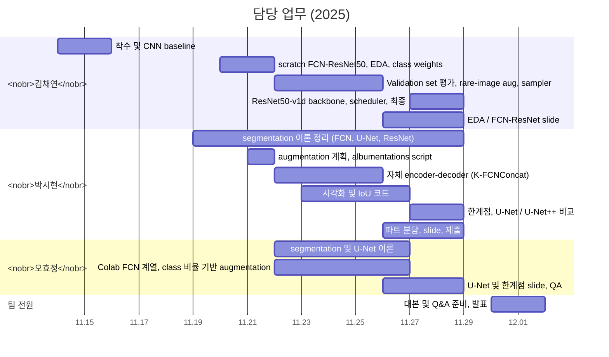

# 팀 기여

[← README](../README_ko.md) · [English](contributions.md) | **한국어**

## 한눈에 보기

수업 이후(2026-10-11 → 17), <nobr>김채연</nobr> 단독: 
`src/autoseg` refactoring·재실행, recipe 탐색, temporal 검증, 결정 보정, U-Net 비교, 
역광 주행과 synthetic glare, ensemble([회고](postmortem_ko.md#수업-이후-2026-10))

| 멤버 | 역할 | 주요 산출물 |
|---|---|---|
| **<nobr>김채연</nobr>** @ChaeYeonKim0204 | FCN-ResNet50 계열, EDA, 평가 최종 실행 전체 | `experiments/chaeyeon/`, `src/autoseg/`, `results/` EDA / FCN-ResNet slide |
| **<nobr>박시현</nobr>** @kha-2 | segmentation 이론, 자체 모델 augmentation, 발표자료 취합 | `experiments/sihyeon/`, augmentation 계획 13개 class 시각화 및 IoU 코드, U-Net / U-Net++ 실행 FCN / ResNet / decoder 정리, 최종 PDF |
| **<nobr>오효정</nobr>** @ohhyojeong | segmentation 이론, Colab FCN 계열 slide QA | `experiments/hyojeong/`, U-Net 정리 U-Net·한계점 slide |

작업 방식:

- 개인 환경에서 학습 후 팀 채팅에 notebook 공유
  - <nobr>김채연</nobr>: Windows laptop
  - <nobr>박시현</nobr>: Colab과 <nobr>박시현</nobr> 개인 PC
  - <nobr>오효정</nobr>: Colab
- 저녁에는 연구실이나 과방에서 작업
- 발표 대본과 Q&A 준비는 팀 전원 공동 작업

---

## 날짜별 담당 업무

| 날짜 | 멤버 | 작업 | 결과 |
|---|---|---|---|
| 11.14 | <nobr>김채연</nobr> | segmentation 강의 PDF, 실습 notebook, 참고 자료 공유 프로젝트 채팅방 개설 | 착수 |
| 11.15 | <nobr>김채연</nobr> | 전체 frame 대상 3-block CNN baseline | 82.95 / 43.85 |
| 11.19 | <nobr>박시현</nobr> | FCN·U-Net 이론 정리 (encoding, 1×1 conv, strided transposed conv, skip sum vs concat) | 팀 내 segmentation 용어 공유 |
| 11.20 | <nobr>김채연</nobr> | scratch FCN-ResNet50(dilated ResNet-50, FCN head, aux head 0.4) early stop, checkpoint | 첫 FCN weights |
| 11.21 | <nobr>김채연</nobr> | EDA → class weights 1/log(1.02 + p) · loss normalization 수정 Validation 사용 관련 교수님께 메일 | 이후 모든 실행에 weighted CE 적용 |
| 11.21 | <nobr>박시현</nobr>, <nobr>오효정</nobr> | 교수님 답변 검토 → 팀 결정: Validation은 평가·모델 선택에 사용, 학습에는 사용 금지 UPerNet / DCN 조사(<nobr>박시현</nobr>) | 프로젝트 평가 기준 |
| 11.21 | <nobr>박시현</nobr> | augmentation 계획(색상, flip, rotate, crop, solarize, cutout, blur) albumentations 기반 FCN-ResNet50 script | `sihyeon/01_251121` |
| 11.21 | <nobr>김채연</nobr> | rare-image augmentation 아이디어 · Kaggle 및 논문 조사 per-image best / middle / worst 분석 아이디어 | 11.22‑23 변경의 근거 |
| 11.22 | <nobr>김채연</nobr> | Validation 폴더를 원본 해상도로 평가 | Validation set 기준 첫 수치: 51.21 |
| 11.22 | <nobr>박시현</nobr> | 자체 encoder–decoder `khaha` skip 크기 불일치를 interpolation으로 해결 | `sihyeon/02_251122` |
| 11.22 | <nobr>오효정</nobr> | class weights 적용 FCN-ResNet50을 Colab으로 port | 두 epoch 기록 |
| 11.23 | <nobr>김채연</nobr> | mIoU 기준 checkpoint 선택 rare image 대상 `aug_factor` 1.0 / 0.4, normalised weights, ×3 `WeightedRandomSampler` | 52.79 → 52.08 |
| 11.23 | <nobr>박시현</nobr> | 512×512 전체 pipeline, 13개 class palette 시각화 per-class IoU block | slide 시각화 스타일 |
| 11.24‑25 | <nobr>박시현</nobr> | `khaha` 10 / 20 epoch · augmentation 실행 BatchNorm + CE + Dice 버전 | 49.45 → 52.16 · 3.67 · 51.61 |
| 11.25 | <nobr>김채연</nobr> | 강화 augmentation(jitter 0.7–1.3, rare image에 blur) | **54.04**(epoch 17) |
| 11.25 | <nobr>오효정</nobr> | U-Net 구조 정리 Colab FCN에 class 비율 기반 flip / rotate augmentation 적용 | U-Net slide label shape 오류로 augmentation 실행 중단 |
| 11.26 | <nobr>박시현</nobr> | 파트 분담안 · 시각화 및 IoU 코드 · ResNet 정리 | 팀 공지로 게시 |
| 11.26 | <nobr>김채연</nobr> | EDA 및 architecture slide | slide 작업 시작 |
| 11.26‑27 | <nobr>김채연</nobr> | class별 이미지 수 확인: RoadLines·TrafficSigns는 이미지의 95–97 %에 존재, Pedestrians만 rare | 회고 분석 근거 |
| 11.26 | <nobr>오효정</nobr> | 검토 후 Colab FCN notebook에 mIoU 평가 호출 추가 | Colab FCN 계열 작업 종료 |
| 11.27 | <nobr>김채연</nobr> | Bag of Tricks 확인 · `FCN_ResNet50_v1d` pixel accuracy 기준 선택 · `ReduceLROnPlateau` · 세 차례 실행 | 52.87 / 51.16 / **55.11** |
| 11.27 | <nobr>박시현</nobr> | ResNet 서론 번역 · degradation 논의 | 이론 slide |
| 11.28 | <nobr>김채연</nobr> | 최종 recipe 적용 FCN · FCN head 및 upsampling 정리 v1d 비교 표 | 53.61 · 모델 slide |
| 11.28 | <nobr>박시현</nobr> | U-Net / U-Net++ 비교 그림 · 자체 모델 한계점 부제·참고문헌 수정 · **PDF 제출** | 제출 |
| 11.28 | <nobr>오효정</nobr> | Bottleneck 설명 · 참고문헌 및 서식 QA | 최종 QA |
| 12.01 | 팀 전원 | 발표 대본, Q&A 준비, 발표 | 발표 완료 |
| 2026.10.11‑12 | <nobr>김채연</nobr> | 최종 notebook을 `src/autoseg`로 refactoring 최종 recipe 재실행 | checkpoint에서 55.11 재현 재실행 51.80 / 54.87 |
| 2026.10.12‑14 | <nobr>김채연</nobr> | Recipe 탐색: backbone·augmentation, schedule, optimizer, crop, epochs 단계별 3 seeds | 51.95 → 58.82 |
| 2026.10.15 | <nobr>김채연</nobr> | Dice + 100 epochs TTA, optical-flow, ConvGRU 검증 · 클래스별 결정 보정 | **60.47 ± 0.89** TTA + 보정 적용 시 61.15 / 61.83 |
| 2026.10.15‑16 | <nobr>김채연</nobr> | 수업 recipe와 최종 recipe의 U-Net 비교 | 50.87 / 62.70 (FCN 52.64 / 60.47) |
| 2026.10.16‑17 | <nobr>김채연</nobr> | 역광 주행 F5 / F7 진단 · synthetic glare augmentation과 검증 glare FCN·U-Net · ensemble · context 검증 | **63.58**(glare FCN) ensemble 67.96 |

---

## <nobr>김채연</nobr>

**착수 및 환경**

- 모든 FCN 계열 실행을 Windows laptop 한 대에서 학습(torch 2.9.1 + CUDA 12.8)
- 강의 PDF, 실습 notebook, 참고 자료, 프로젝트 채팅방 (11.14)

**모델**

- 3-block CNN baseline: pixel accuracy 82.95, mIoU 43.85 (11.15)
- scratch FCN-ResNet50 (11.20):
  - Bottleneck, dilation [1,2,2,2,2,2] / [2,4,4]
  - FCN head 및 aux head, early stop과 checkpoint
- Bag of Tricks backbone (11.27–28):
  - 코드에 Bag of Tricks 기법이 없음을 확인한 뒤 제안
  - 3×3 stem과 AvgPool shortcut을 쓰는 `FCN_ResNet50_v1d` · shape 오류 수정
  - 원본 vs v1d 비교 표

**데이터 및 평가**

- EDA: per-class pixel 비율, 이미지당 class 수, label 범위 
  class weights 1/log(1.02 + p)와 normalization (11.21–23)
- 75 %가 training sequence의 random split 평가치임을 발견 
  평가를 원본 해상도 Validation 폴더로 전환 (11.22)
- mIoU 기준 checkpoint 선택(11.23)
- rare-image augmentation 계수, ×3 oversampling, per-image accuracy 분포 
  best / middle / worst 그림 (11.23–25)
- RoadLines·TrafficSigns가 이미지의 95–97 %에 등장함을 확인(rare class는 Pedestrians뿐) (11.26–27)
- 속도를 위해 선택 기준을 pixel accuracy로 변경, `ReduceLROnPlateau` 추가 · 최종 실행 55.11 (11.27)
- Validation 사용 관련 교수님께 메일 (11.21)

**slide**

- EDA 및 Model Architecture slide, FCN-ResNet slide (11.26–28)
- ResNet degradation / constructed solution 정리, 참고문헌

**수업 이후 (2026-10)**

- `src/autoseg` package와 최종 recipe 재실행(10.11–12)
- Training 속도 epoch당 115 → 41 s(10.12–15)
- 단계별 세 seeds로 recipe 탐색(10.12–15): 
  cosine schedule, AdamW 5e-4, 전체 frame, 60 → 100 epochs, Dice → 60.47 ± 0.89
- Evaluation-only 분석(10.15):
  - flip / multi-scale TTA, optical-flow 평균, flicker, per-sequence mIoU
  - ConvGRU head
  - leave-one-sequence-out 검증을 적용한 클래스별 결정 보정
- 두 recipe의 U-Net 비교(10.15–16)
- 역광 주행과 ensemble(10.16–17):
  - frame별 분석: 역광 Validation 주행 F5 / F7에 최저 성능 frame 집중
  - 학습 전 나머지 주행에서 검증한 synthetic glare augmentation(`data.add_glare`)
  - glare FCN 63.58, glare U-Net 65.06
  - ensemble 최대 67.96(모델 두 개), 69.00(여섯 개) · context 검증

---

## <nobr>박시현</nobr>

**평가 기준 및 augmentation**

- 교수님 답변 검토로 팀 평가 기준 확정(11.21): 
  Validation은 평가·모델 선택에 사용, 학습에는 사용 금지
- UPerNet / DCN 조사
- 팀과 분담한 augmentation 계획(11.21): 
  색상(brightness, contrast, saturation, hue), horizontal / vertical flip, rotation 및 crop, solarize, cutout, blur
- albumentations 기반 FCN-ResNet50 학습 script(11.21):
  - 256×256 RandomResizedCrop, ImageNet normalization
  - ignore 255 CE, aux 0.4, Adam 1e-4
  - 최신 albumentations에서 CoarseDropout 인자 경고

**자체 encoder–decoder (K-FCNConcat)**

- `khaha` (11.22):
  - LeakyReLU를 쓰는 conv block 다섯 개(64 → 1024)
  - 1024-channel bottleneck conv 세 개
  - concat skip을 쓰는 transposed-conv decoder, 1×1 head
- skip 크기 불일치(`torch.cat` 76 vs 75) → skip 크기에 맞춰 bilinear interpolation (11.22)
- 512×512 전체 pipeline, 13개 class palette, per-class IoU block (11.23)
- 10 epoch 49.45, 20 epoch 52.16, augmentation 실행 3.67 (11.24–25)
- weighted CE + Dice, AdamW 1e-3 적용 BatchNorm 버전 → mIoU 51.61 (11.25)
- slide용 한계점 정리(11.28): 
  깊이만 늘림, 1024-channel conv 반복, 1536-channel concat, 1/64 downsampling, encoder channel이 decoder의 두 배

**segmentation 이론**

- 모델 구현 전 FCN·U-Net 정리(11.19)
- FCN-16s / 8s, transposed conv vs deconvolution(11.25)
- ResNet shortcut·residual 정리, 논문 서론 번역, 
  degradation vs vanishing gradient 논의(11.26–27)
- FCN decoder·aux classifier 정리(11.28)

**slide**

- 발표 파트 분담 (11.26)
- 모델 선정 slide용 U-Net·U-Net++ 비교 그림
- 부제·참고문헌 수정, 최종 PDF (11.28)

---

## <nobr>오효정</nobr>

**Colab FCN**

- Colab Drive에서 EDA 기반 class weights와 512 random crop을 적용한 scratch FCN-ResNet50 (11.22)
- ImageNet normalization과 class 비율 기반 flip / rotate augmentation(11.25)
- label shape 오류(RGB label을 단일 channel로 변환하지 않음)로 실행 중단 
  검토 후 mIoU 평가 호출 추가(11.26)

**segmentation 이론**

- 2D segmentation·U-Net 공부(11.25 정리 공유): 
  contracting path, bridge, expanding path, concat skip, 3×3 conv + BN + ReLU, transposed conv
- U-Net slide

**slide 및 팀**

- U-Net(bottleneck) 및 Limitations slide · "Model Introduction" 제목
- 제출 전 참고문헌 중복 / 누락 및 글자 색 확인 (11.28)
