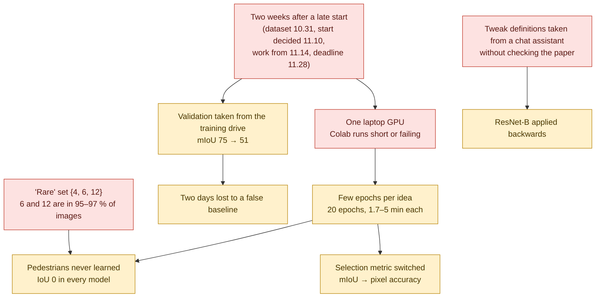
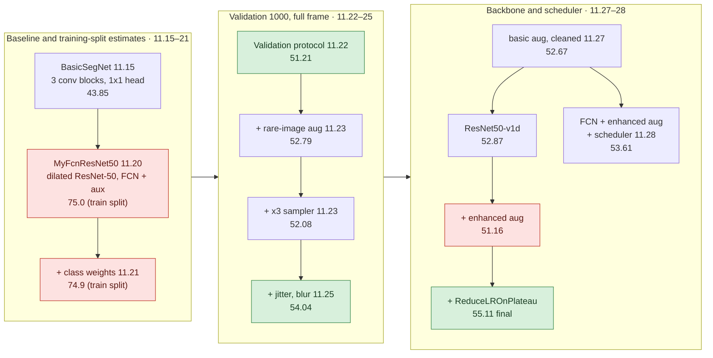

# Post-mortem

[← README](../README.md) · **English** | [한국어](postmortem_ko.md)

## Result in Numbers

| Item | Value |
|---|---|
| Final model | FCN on a scratch ResNet50-v1d backbone enhanced augmentation, ReduceLROnPlateau |
| Validation (1000 images, 800×600) | pixel accuracy 89.78 %, mIoU 55.11 % |
| Strong classes (IoU) | Vehicles 94.2, None 92.2, Roads 86.1, Sidewalks 75.5, Vegetation 71.4 |
| Weak classes (IoU) | Pedestrians 0.0, Other 20.7, Fences 23.8, Walls 36.6, Poles 38.7 |
| Per-image pixel accuracy | best 96.75 %, median 93.09 %, worst 63.75 % |
| Working time | 11.14 → 11.28 (14 days) one GPU laptop for every final number |
| After the course (2026-10) | same model, new recipe: mIoU 60.47 ± 0.89 (3 seeds, last epoch) + synthetic backlight augmentation: 63.58 ± 0.38 ensemble with a U-Net trained the same way: 67.96 ± 0.49 ([below](#after-the-course-2026-10)) |

---

## Root Causes

| # | Problem | Cause | Effect | Lesson |
|:---:|---|---|---|---|
| 1 | mIoU 75 % that was not real | random 800 / 200 split of sequential Training frames | the first two training days gave numbers not comparable with anything later | evaluate on the official split from the first run never validate on a random split of sequential frames |
| 2 | Pedestrians 0 % IoU | 0.006 % of pixels the "rare" set covered 97 % of images | 0 % in every model | check rarity per image, not per pixel a class this small needs its own crop or loss term |
| 3 | One laptop for every final number | Colab runs short or failing | one idea per run no repeated seeds, no sweeps | secure shared compute on day one |
| 4 | Selection metric changed mid-way | per-pixel confusion loop too slow | runs selected by different metrics are not a like-for-like comparison | vectorised confusion matrix, one selection metric |
| 5 | Training instability | 1000 images, fixed Adam 2e-4 | validation accuracy swinging 10–20 points 55.11 depended on epoch 20 | — |
| 6 | ResNet-B applied backwards | tweak description from a chat assistant, not checked against the paper | "v1d" is ResNet-C + D one slide-table line inaccurate | check a tweak against the paper or a reference implementation |
| 7 | Custom model collapsing with augmentation | not found before the deadline | reported K-FCNConcat numbers are from runs without augmentation | — |
| 8 | Theory after the fact | FCN-ResNet line built by re-implementing torchvision first | theory studied 11.26–28, after training | write the architecture slide before training; it is also the design review |

Also: keep an experiment table while running (run id, recipe, numbers). 
Three stale notebook copies cost time when reconstructing this repository.

### 1. The 75 % mIoU came from a random split of the training drive

| Split | Drives (frames) |
|---|---|
| Training | `02_01`, `02_02` (250 consecutive frames each) `F66`–`F70` (about 100 each) |
| Validation | `02_00`, `03_00`, `F5`–`F9` |

No sequence appears on both sides.

| Date | Evaluated on | mIoU | Validation vs training loss |
|---|---|:---:|:---:|
| 11.15 | Validation folder (baseline) | 43.85 | — |
| 11.20–21 | 800 / 200 `random_split` of the Training folder | 75.03 (full frame) 74.93 (crops) | 0.19 vs 0.19 |
| 11.22 | Validation folder, full 800×600 | 51.21 | 1.38 vs 0.26 |

- In the random split, neighbouring frames of one sequence landed on both sides.
- The 200-image score measured memorisation more than generalisation.
- Every number from 11.22 on uses the Validation folder.

### 2. Pedestrians: 0 % IoU in every model

| Pedestrians | Training | Validation |
|---|:---:|:---:|
| Pixel share | 0.006 % (next rarest: TrafficSigns 0.081 %) | 0.0003 % |
| Images containing them | 18 % | 17.7 % (177 images) |

- Pedestrians in Validation are 20× smaller on average than in training.
- Class weight 1/log(1.02 + p), mean 1: Pedestrians 2.04 vs Roads 0.21. 
  That is a 10× ratio for a 3000× pixel imbalance.
- The "rare" set {Pedestrians, RoadLines, TrafficSigns} drove the ×3 `WeightedRandomSampler` and the stronger augmentation.
  - RoadLines and TrafficSigns are in 97 % and 95 % of images.
  - 97 % of images counted as rare, so the sampler changed almost nothing.
  - Found on 11.26–27, not changed before the deadline.
- Random 512×512 crops of an 800×600 frame drop a pedestrian entirely in most samples.
- Not run: pedestrian-centred crops, a Pedestrians-only sampler, Dice / focal loss on the FCN line, a higher pedestrian weight. 
  (A pedestrian-centred crop was proposed on 11.23 and written in the Colab FCN notebook, but never used.)
- Estimate: 20 % pedestrian IoU would add about 1.5 mIoU points (one class is 1/13 of the mean).

### 3. One laptop for every final number

| Machine | What happened |
|---|---|
| Colab | FCN port: two epochs logged (11.22) augmented FCN: label-shape error on a CPU runtime (RGB label not reduced to one channel, 11.25) |
| Colab + Sihyeon Park's own PC | custom model, with its own pipeline |
| Laptop (torch 2.9.1 + CUDA 12.8) | 4.2–6.2 min per epoch with mIoU every epoch 1.7–2.0 min per epoch with pixel accuracy only 35–120 min per 20-epoch run · 12 runs in 14 days |

### 4. Checkpoint selection changed mid-way

| Dates | Selection metric |
|---|---|
| 11.22 | validation loss |
| 11.23–27 | validation mIoU (patience 5) |
| 11.27–28 | validation pixel accuracy (the per-pixel confusion loop was too slow) |

- Pixel accuracy favours Roads / None / Vehicles.
- Final model: best accuracy at epoch 20, lowest validation loss at epoch 8 (1.17). The best-mIoU epoch is not necessarily epoch 20.
- So the 54.04 run (mIoU-selected) and the 53.61 / 55.11 runs (accuracy-selected) are not an apples-to-apples ablation.
- No test set: the Validation folder served both selection and reporting (allowed by the course, stated on the slides).
- Now: vectorised confusion matrix (`torch.bincount`, `src/autoseg/engine.py`).

### 5. Training instability

- Validation accuracy dropped 10–20 points between neighbouring epochs: 
  64.67 % at epoch 8 of the v1d basic run, 72.33 % at epoch 11 of the v1d enhanced-augmentation run.
- Validation loss spiked to 2.19 / 2.45 while training loss stayed near 0.2.

| Run | Without scheduler | With `ReduceLROnPlateau` (factor 0.5, patience 1 on validation accuracy) |
|---|:---:|:---:|
| v1d + enhanced aug | 51.16 (stopped at epoch 14) | **55.11** (20 epochs) |
| plain FCN + enhanced aug | 54.04 | 53.61 (selection metric also changed) |

- On v1d, enhanced augmentation without the scheduler lowered mIoU (52.87 → 51.16). 
  Stronger augmentation needed more epochs than early stopping allowed.

Re-runs of the final recipe in 2026-10 (`src/autoseg`, RTX 4070 Ti):

| Run | Early stop | Kept epoch | Pixel acc | mIoU |
|---|:---:|:---:|:---:|:---:|
| torch 2.14, accuracy selection | epoch 18 | 13 | 87.37 | 51.90 |
| original env (torch 2.9.1), accuracy selection | epoch 16 | 11 | 89.46 | 51.80 |
| original env, `--select miou` | — | 17 | 89.53 | 54.87 |

- In the torch 2.9.1 accuracy run, mIoU peaked at 53.57 % in epoch 14; the accuracy criterion did not keep it.
- The course run reached 55.11 % only because validation accuracy kept creeping up to epoch 20.
- `--select miou` is free with the vectorised confusion matrix; it ended 0.24 points under the course run.
- 51.80 vs 54.87 in the same environment is the cost of the §4 metric switch.

### 6. ResNet-B applied backwards

| Tweak (Bag of Tricks, He et al., 2019) | Definition | In the v1d code |
|---|---|---|
| ResNet-B | stride moved from the 1×1 conv1 to the 3×3 conv2 | reversed: stride on conv1 (the original `MyFcnResNet50` already had it on conv2, torchvision layout) |
| ResNet-C | 7×7 stem replaced by three 3×3 convs | as defined |
| ResNet-D | shortcut downsampled with AvgPool + 1×1 conv | as defined |

- The description used while coding on 11.27 had B reversed.
- So the "v1d" backbone is ResNet-C + D on a non-B bottleneck.
- Only the first block of layer2 has a stride, so the numeric impact is small. 
  The "ResNet-B + ResNet-D" line in the comparison table is inaccurate.
- Another unverified claim from the same source: torchvision's auxiliary loss weight (0.5, not 0.4).

### 7. Augmented training collapsing (custom model)

| `khaha`, 20 epochs | mIoU |
|---|:---:|
| without augmentation | 52.16 |
| with the augmentation dataset | 3.67 (None 34, Vegetation 10, Poles 3, the rest 0) |

- Cause not found before the deadline. Candidates:
  - image and mask transformed independently
  - normalisation applied in one dataset class only
  - label values changed by interpolation
- The reported K-FCNConcat numbers (49.45 / 52.16 / 51.61) come from runs without augmentation.
- The improved version on the slides (BatchNorm, single conv6, augmentation, scheduler) has no surviving notebook.

### 8. Theory after the fact (FCN-ResNet line)

- Team theory came from Sihyeon Park's and Hyojeong Oh's notes (FCN, U-Net, transposed convolution, ResNet; 11.19–11.27).
- The FCN-ResNet line was built by re-implementing torchvision's layout first.
- Its theory was studied on 11.26–28 while writing the slides, after training: 
  ResNet degradation vs vanishing gradient, the constructed solution, FCN upsampling, the aux head.
- Open points from the 12.01 Q&A preparation: 
  augmentation frequency vs strength, which bottlenecks get B/C/D, early-stop semantics.

---

## Tried and Dropped

| Idea | Who / when | Outcome |
|---|---|---|
| Mini U-Net baseline + ASPP-style dilated bottleneck + CE + Dice (kick-off strategy draft) | Chaeyeon&nbsp;Kim, 11.14 | Not followed the FCN-ResNet50 layout was built instead |
| torchvision `deeplabv3_resnet50(weights=None)` as a comparison | Chaeyeon&nbsp;Kim, 11.23 | Planned, never run |
| Training only on images that contain all 13 classes | Chaeyeon&nbsp;Kim, 11.25 | Rejected (would drop most of the data) |
| Vertical flip, solarize, cutout | Sihyeon&nbsp;Park's augmentation plan 11.21–25 | Vertical flip rejected for driving scenes solarize not implemented cutout silently disabled by an albumentations API change |
| UPerNet, DCN backbones | Sihyeon&nbsp;Park, 11.21 | Surveyed, not built (time) |
| Pedestrian-centred crop | idea Chaeyeon&nbsp;Kim 11.21 code Hyojeong&nbsp;Oh 11.22–25 | Written in the Colab FCN notebook never wired into training |
| Dilated-bottleneck decoder for the FCN line | Chaeyeon&nbsp;Kim, 11.23 | Dropped in favour of the backbone switch |

---

## Model Evolution

Parallel lines:

- Sihyeon Park's `khaha` (U-Net-style concat decoder): 49.45 → 52.16 → 51.61 with BatchNorm and CE + Dice
- U-Net / U-Net++ comparison for the slides (numbers on the slides only)
- Hyojeong Oh's Colab FCN-ResNet50 with class-ratio augmentation (no completed run)

---

## Experiment Log

Full table with recipes and per-class IoU: 
[results/experiments.csv](../results/experiments.csv), [results/class_iou.csv](../results/class_iou.csv)

| Run | Change | Pixel acc | mIoU | Note |
|---|---|---|---|---|
| C00 11.15 | 3-block CNN, no aug | 82.95 | 43.85 | |
| C01 11.20 | scratch FCN-ResNet50, full frame, no weights | 96.53 | 75.03 | train-split estimate |
| C02 11.21 | class weights, flip + crop, 20 epochs | 95.55 | 74.93 | train-split estimate |
| C04 11.22 | Validation 1000 at full frame, blur removed | 87.73 | 51.21 | first validation-set number |
| C05 11.23 | rare-image aug factor 1.0 / 0.4, raw weights | 88.50 | 52.79 | |
| C06 11.23 | normalised weights, ×3 sampler | 87.50 | 52.08 | |
| C07 11.25 | jitter 0.7–1.3, blur 1.5 on rare images best epoch 17 | 90.17 | 54.04 | mIoU-selected |
| C08 11.27 | basic aug (flip + crop) | 87.61 | 52.67 | slide "Basic" column |
| C09 11.27 | ResNet50-v1d, basic aug | 88.02 | 52.87 | early stop epoch 17 val acc 64.67 at epoch 8 |
| C10 11.27 | v1d + enhanced aug | 86.90 | 51.16 | early stop epoch 14 |
| C11 11.27 | v1d + enhanced aug + scheduler | **89.78** | **55.11** | final |
| C12 11.28 | FCN-ResNet50 + enhanced aug + scheduler | 90.16 | 53.61 | early stop epoch 17 |
| S03 11.25 | khaha + BN, CE + Dice | — | 51.61 | earlier khaha runs: 49.45 (10 ep), 52.16 (20 ep), 3.67 (aug) |

Stale copies kept out of the table:

- `251123_0249` (same outputs as `251123_0030`)
- `251125_1523` (same outputs as `251125_0035`)
- `251121_2136` (outputs from the training split)

---

## Troubleshooting Log

| Date | Symptom | Cause | Fix |
|---|---|---|---|
| 11.21 | `evaluate_seg` would raise `TypeError` | class-weights argument not accepted loss divided by the wrong count | signature and normalisation fixed |
| 11.21 | `UserWarning: Argument(s) 'max_holes, max_height, max_width, fill_value, mask_fill_value' are not valid for transform CoarseDropout` | albumentations API change | ignored; cutout effectively off |
| 11.21 | `ModuleNotFoundError: No module named 'cv2'` | albumentations script run on the laptop without OpenCV | script kept on Colab |
| 11.22 | `RuntimeError: Sizes of tensors must match except in dimension 1. Expected size 76 but got size 75` in `torch.cat((x, skip4))` | 800×600 input not divisible by 2⁵ | `F.interpolate(x, size=skip.shape[2:])` before concat |
| 11.22 | mIoU 75 on 11.20‑21 vs 51 on 11.22 | validation drawn as a random split of the training drive | Validation folder |
| 11.25 | `RuntimeError: only batches of spatial targets supported (3D tensors) but got targets of dimension: 4` (Colab FCN) | RGB label PNG not reduced to one channel, not resized | not fixed before the deadline |
| 11.25 | custom model mIoU 3.67 with augmentation | not found | augmentation dropped |
| 11.26 | Colab FCN notebook prints no mIoU | `evaluate_miou` defined, never called | call added |
| 11.27 | `RuntimeError` 128 vs 127, 64 vs 128 in `out += identity` | AvgPool kernel ≠ stride, then a shortcut without downsampling while porting the v1d backbone | `AvgPool2d(stride, stride, ceil_mode=True)` + 1×1 conv |
| 11.27 | `TypeError: ReduceLROnPlateau.__init__() got an unexpected keyword argument 'verbose'` | removed in torch 2.9 | argument dropped |
| 11.27 | `TypeError: unsupported operand type(s) for *: 'NoneType' and 'int'` in the curve plot | per-epoch mIoU list empty after switching to accuracy-only validation | plot cell adjusted |

---

## After the Course (2026-10)

Worked on by Chaeyeon&nbsp;Kim from 2026-10-11 to 10-17, on the same machine. Three questions:

1. How far does the course model (FCN on the ResNet50-v1d backbone, no pretrained weights) go with a better training recipe?
2. What changes once the frame sequences missed in the EDA are taken into account?
3. Where do the remaining errors come from?

Files:

- Runs: [results/postcourse_runs.csv](../results/postcourse_runs.csv)
- Backlit vs other drives: [results/postcourse_backlit.csv](../results/postcourse_backlit.csv)
- Commands: [experiments/postcourse/](../experiments/postcourse/README.md)

> There is no separate test set, so Validation was not used for training; it was used to select checkpoints and hyperparameters and to fit the decision bias. All reported numbers are on Validation. 
> The synthetic backlight augmentation (§3) was designed by comparing with backlit Validation frames. 
> Screening and adoption rules were written down before the runs they decide.

### Training speed

115 → 41 s per epoch at 512 crops (62 s at full frame), before any recipe change. 
A 100-epoch run takes about 1 h 50 min.

| Change | s / epoch |
|---|:---:|
| Persistent workers and pinned memory | 115 → 83 |
| PNG decode cache (`--cache-dir`) | 83 → 81 |
| bf16 autocast | 81 → 45 |
| channels_last | 45 → 42 |
| `cudnn.benchmark` | 42 → 41 |

### 1. How far the course model goes

Decision metric: mean Validation mIoU of the last 5 epochs. 
Each step is the mean ± standard deviation of seeds 42, 1 and 2.

| Step | Change | Last 5 epochs | Last epoch | Best epoch |
|---|---|:---:|:---:|:---:|
| 0 | Course recipe re-run Adam 2e-4, ReduceLROnPlateau, 20 epochs, 512 crop, early stop on pixel accuracy | 51.95 ± 1.79 | 52.71 ± 1.71 | 52.81 ± 1.75 |
| 1 | Cosine schedule (1 warm-up epoch), 30 epochs, no early stop | 53.78 ± 0.97 | 53.82 ± 1.08 | 54.11 ± 0.92 |
| 2 | AdamW 5e-4, weight decay 1e-2 | 55.77 ± 1.14 | 55.73 ± 1.25 | 56.14 ± 1.16 |
| 3 | Full 800×600 frames instead of 512 crops | 56.98 ± 0.31 | 57.05 ± 0.31 | 57.25 ± 0.40 |
| 4 | 60 epochs | 58.82 ± 0.66 | 58.86 ± 0.71 | 59.51 ± 0.43 |
| 5 | + 0.5 Dice, 100 epochs (**new recipe**) | 60.52 ± 0.87 | **60.47 ± 0.89** | 60.96 ± 0.64 |
| 6 | + synthetic backlight on 30 % of the training images (§3) | 63.65 ± 0.34 | **63.58 ± 0.38** | 64.02 ± 0.18 |

- Step 0 with the course rule (checkpoint chosen by pixel accuracy): 52.64 ± 2.03.
- Course run for reference: 55.11 (one seed).

Before step 1, single-seed runs with the course pipeline (30 epochs, Windows):

| Change | mIoU |
|---|:---:|
| Enhanced augmentation instead of flip + crop | +1 to +2 |
| ReduceLROnPlateau | −0.9 to −1.2 |
| Early stop with patience 10 (best epochs at 28–30) | −1.0 to −1.4 |

Checked and not adopted:

| Change | Result | Compared with |
|---|:---:|---|
| EMA of the weights (0.999) | 54.10 | cosine 54.24 (seed 42) |
| Poly schedule | 53.36 | cosine 54.24 |
| SGD 0.01 / 0.02 | 51.61 / 51.29 | AdamW 5e-4 56.48 (seed 42) |
| Batch 8 | 55.48 | batch 4 56.48 |
| Plain FCN-ResNet50 backbone | 54.42 ± 0.36 | C+D 55.77 ± 1.14 (step 2) |
| B+C+D backbone (ResNet-B added) | 55.90 ± 0.38 | C+D 55.77 ± 1.14 C+D kept as the course model |
| 576×768 crop | 56.67 | full frame 56.98 ± 0.31 |
| Scale augmentation 0.75–1.5 | 57.71 | screening threshold 59.32 |
| Two-frame input (t−1 and t as 6 channels) | 58.00 | screening threshold 59.32 |

Screening: seed 42, full frame, 60 epochs; kept if above the step-4 mean + 0.5 = 59.32. 
Dice 0.5 → 59.99 and 100 epochs → 59.42: both kept and combined in step 5.

Inference only, on the three step-5 models (last epoch):

| Variant | mIoU |
|---|---|
| One forward pass | 60.47 ± 0.89 |
| Flip TTA | 60.63 ± 1.00 |
| Multi-scale TTA (0.75 / 1 / 1.25, each with its flip) | 59.58 ± 1.01 |
| Logit adjustment −τ·log(class prior) | best τ between −0.125 and 0 in every fold: no change |
| Flip TTA + per-class decision bias, fitted on the other six sequences | 61.15 ± 0.73 |
| Flip TTA + per-class decision bias, fitted on all of Validation | 61.83 ± 0.72 (seed 42 / 1 / 2: 61.57 / 62.64 / 61.28) |

Fitted biases: Buildings −2.3 in every fold, Poles about −2.1, TrafficSigns about +0.9.

| Mean over seeds | Without bias | With bias |
|---|:---:|:---:|
| Other predicted as Buildings (% of Other pixels) | 44.0 % | 38.6 % |
| Walls predicted as Buildings | 27.7 % | 20.6 % |
| RoadLines predicted as Roads | 13.7 % | 22.3 % |
| Buildings IoU | 65.2 | 70.2 |

How the decision bias is fitted

 

- Prediction = argmax over classes of log p + b, one b per class (None fixed at 0).
- Found by coordinate ascent within ±2 on a stride-4 pixel grid.
- `autoseg.calibrate`, applied with `evaluate --bias-json`.
- Each Validation sequence is scored with the bias fitted on the other six; the pooled result is the 61.15 row.
- A ±4 search gave 61.02 in the same check.

### 2. What the EDA missed: the frames are sequences

| Frames | Training | Validation |
|---|:---:|:---:|
| Drives | 7 (two of 250 frames, five of 100) | 7 (two of 250 frames, five of 100) |
| Pixels that differ, consecutive frames (median) | 6.9 % | 6.8 % |
| Pixels that differ, random pairs | 35.5 % | 30.6 % |

- No drive appears on both sides.
- A random 800 / 200 split of Training puts near-copies of each validation frame in training: 
  74.93 on that split (11.21) vs 51.21 on Validation (11.22).

Per-sequence mIoU of the step-5 models (mean of 3 seeds):

| Sequence | 02_00 | 03_00 | F5 | F6 | F7 | F8 | F9 |
|---|:---:|:---:|:---:|:---:|:---:|:---:|:---:|
| mIoU | 67.2 | 65.5 | **35.6** | 54.9 | **33.1** | 75.2 | 59.9 |

Using the neighbouring frames:

| Method | mIoU | vs one frame |
|---|:---:|:---:|
| Mean of t−1, t, t+1 probabilities | 54.30 | −6.2 |
| t−1 warped with DIS optical flow, forward-backward consistency mask, averaged with t | 60.53 | +0.06 |
| Same with t−1 and t+1 | 60.75 | +0.28 |
| Two-frame input (seed 42, 60 epochs) | 58.00 | step 4: 58.82 |
| ConvGRU head on the frozen backbone (3-frame clips, 10 epochs) minus the same head without the GRU | −0.07 (3-frame window) −0.20 (whole sequence) | — |

Why averaging frames barely helps:

| Measure (step-5 models) | Value |
|---|:---:|
| Flicker, one frame | 2.48–2.57 % |
| Flicker, flow-aligned average | 1.48–1.54 % |
| Flicker of the ground-truth labels | 1.57 % |
| Wrong pixels per frame (1 − pixel accuracy) | 7.7–9.1 % |
| Pixels that change between frames | 2.5 % |

- Flicker: the share of pixels whose predicted label changes between consecutive frames, in flow-aligned coordinates, where the ground truth does not.
- Averaging neighbouring frames can only act on the pixels that change.

| Averaged predictions | Gain |
|---|---|
| Neighbouring frames of one model | +0.3 |
| Three seeds of one architecture | +0.8 (FCN) / +1.5 (U-Net) |
| FCN + U-Net (§5) | +2.0 over U-Net, +4.2 over FCN |

The more different the averaged predictions, the larger the gain.

### 3. Backlit drives: a condition missing from Training

- F5 and F7 face the sun for their whole length; no Training drive does.
- For all six step-5 models (FCN and U-Net, 3 seeds each), every frame among the 10 % with the lowest pixel accuracy is from F5 or F7.
- The worst image of the course model (63.75 %, F7-50) is one of them.

Which classes fail on F5 + F7 (FCN, mean of 3 seeds):

| Class | Other five drives | F5 + F7 |
|---|:---:|:---:|
| Roads | 96.7 | 51.6 |
| RoadLines | 74.2 | 7.4 |
| Buildings | 89.7 | 21.1 |
| Sidewalks | 85.2 | 59.1 |

- The glared wet road is predicted as Buildings (35 % of road pixels), and the road lines vanish. U-Net fails the same way.
- Neighbouring frames do not help there. F5 + F7 with the flow-aligned average: 36.60 (FCN) and 33.68 (U-Net), against 36.67 and 33.56 with one frame.

`data.add_glare` (`train --glare P`):

| Part | Effect |
|---|---|
| Whole image | sepia wash, darker mid-tones (silhouettes), bright sky |
| Horizon | a diffuse glow |
| Road below the sun | a widening sheet of shine |
| Road pixels (from the label) | a mottled wet texture with specks flat puddles that mirror the scene above the horizon |

The look was tuned by comparing with F5 / F7 frames (Validation images were looked at, not used for training).

Check before training (`experiments/postcourse/glare_check.py`): 
the five non-backlit Validation drives with synthetic glare, scored with the step-5 models.

| Model | Other five drives | + synthetic glare | Real F5 + F7 |
|---|:---:|:---:|:---:|
| FCN | 67.13 | 40.22 | 36.67 |
| U-Net | 70.65 | 32.14 | 33.56 |

Also close to the real failure: RoadLines 5.7 (real 7.4), road → Buildings 15.6 % (real 35 %).

Training:

- New recipe and seeds 42 / 1 / 2, glare on 30 % of the training images.
- The glare draws from its own random stream, so initialisation, sampling order, flips and crops follow the runs without glare.
- Rule fixed before the runs:
  - on F5 + F7, the glare model is above the same-seed model for all three seeds, with a mean gain of at least +3
  - the other five drives change by no less than −0.5 on average

| Model (3 seeds, last epoch) | All 7 drives | F5 + F7 | Other five |
|---|:---:|:---:|:---:|
| FCN | 60.47 ± 0.89 | 36.67 | 67.13 |
| FCN + glare 30 % | **63.58 ± 0.38** | **50.56** | 66.86 |
| U-Net | 62.70 ± 0.50 | 33.56 | 70.65 |
| U-Net + glare 30 % | **65.06 ± 0.30** | 42.09 | **72.18** |

Glare model minus the same-seed model (seeds 42 / 1 / 2):

| Model | F5 + F7 | Other five | All drives | Rule |
|---|:---:|:---:|:---:|:---:|
| FCN | +14.5 / +10.2 / +17.0 (mean +13.9) | +0.05 / −0.16 / −0.72 (mean −0.28) | +3.8 / +1.9 / +3.6 (mean +3.1) | met |
| U-Net | +6.4 / +12.2 / +7.0 (mean +8.5) | +1.7 / +1.1 / +1.8 (mean +1.5) | +1.9 / +3.1 / +2.1 (mean +2.4) | met |

- On F5 + F7, the FCN ranged 33.8–40.2 across seeds, the glare FCN 50.4–50.8.
- Share of F5 / F7 frames among the 10 % worst frames: 
  glare FCN 52 / 73 / 58 % (seeds 42 / 1 / 2), glare U-Net still 100 %.

Per class, mean of 3 seeds:

| Class | FCN | Glare FCN |
|---|:---:|:---:|
| Roads | 87.2 | 95.4 |
| Buildings | 65.2 | 83.2 |
| RoadLines | 62.1 | 70.9 |
| Walls | 48.0 | 42.0 |
| TrafficSigns | 66.8 | 64.2 |

### 4. FCN vs U-Net

Classic U-Net (same padding + BatchNorm, 31.0 M parameters, no auxiliary head, no pretrained weights). 
Same recipes and seeds 42, 1, 2.

Course choice of FCN-ResNet50:

- U-Net-family models were expected from most teams, and creativity of the model design was worth 30 points.
- So the aim was to show how far an older, generally weaker architecture can go.
- U-Net needs 1.5–1.6× the GPU memory (table below).
- Slides: U-Net 48.69, U-Net++ 44.73 (10 epochs, Sihyeon&nbsp;Park) vs FCN-ResNet50 55.11

| Recipe (3 seeds) | FCN-ResNet50-v1d | U-Net |
|---|:---:|:---:|
| Course recipe (checkpoint by pixel accuracy) | **52.64 ± 2.03** | 50.87 ± 1.90 |
| New recipe, last epoch | 60.47 ± 0.89 | **62.70 ± 0.51** |
| New recipe, best epoch | 60.96 ± 0.64 | 63.84 ± 0.94 |
| New recipe + flip TTA + decision bias, fitted on the other six sequences | 61.15 ± 0.73 | 63.48 ± 0.72 |
| New recipe + flip TTA + decision bias, fitted on all of Validation | 61.83 ± 0.72 | 64.29 ± 0.62 |
| New recipe + glare 30 %, last epoch | 63.58 ± 0.38 | **65.06 ± 0.30** |
| Peak GPU memory, 512 crop / full frame (batch 4, bf16) | 3.2 / 5.5 GB | 4.8 / 8.8 GB |
| Time per epoch, 512 crop / full frame | 40 / 64 s | 45 / 73 s |

Course recipe → new recipe: FCN +7.8, U-Net +11.8 (last epoch; course recipe with the course selection rule).

Best single seed, new recipe (FCN seed 1, U-Net seed 42):

| Evaluation | FCN-ResNet50-v1d (seed 1) | U-Net (seed 42) |
|---|:---:|:---:|
| Last epoch | 61.45 | 63.22 |
| Best epoch | 61.70 (epoch 71) | 64.65 (epoch 71) |
| + flip TTA + decision bias, fitted on the other six sequences | 61.99 | 64.22 |
| + flip TTA + decision bias, fitted on all of Validation | **62.64** | **64.84** |

Per-class IoU, U-Net minus FCN under the new recipe (mean of 3 seeds, all drives):

| Class | Fences | RoadLines | Vegetation | Buildings | TrafficSigns | Walls | Vehicles | Roads |
|---|:---:|:---:|:---:|:---:|:---:|:---:|:---:|:---:|
| U-Net − FCN | +15.4 | +15.1 | +5.5 | +4.8 | +3.9 | −11.6 | −2.4 | −2.0 |

Pedestrians: 0 for both. On F5 + F7, FCN is ahead:

| F5 + F7 | Roads | Walls | Vehicles |
|---|:---:|:---:|:---:|
| FCN | 51.6 | 42.2 | 96.6 |
| U-Net | 41.7 | 19.7 | 89.0 |

U-Net, inference only

 

- Flip TTA 62.95 ± 0.43, multi-scale TTA 62.70 ± 0.33, flow-aligned t±1 62.52 ± 0.51
- Logit adjustment: best τ +0.125 to +0.5 (FCN: −0.125 to 0), +0.01 to +0.04 in the cross-check

Context check (`experiments/postcourse/context_check.py`, no retraining, step-5 models, 3 seeds): 
each 400×300 quarter of the frame predicted on its own and stitched.

| Model | Other five drives | F5 + F7 |
|---|:---:|:---:|
| FCN | 67.13 → 54.26 | 36.67 → 28.89 |
| U-Net | 70.65 → 62.86 | 33.56 → 28.74 |

- Without the rest of the frame, the FCN's lead on F5 + F7 disappears: 
  Roads 51.6 → 35.8 vs U-Net 41.7 → 35.4.
- U-Net's RoadLines barely change: 98.0 → 97.6 (FCN 74.2 → 55.0).

### 5. Ensembles

Equal-weight mean of softmax, no weights fitted (`autoseg.ensemble`). 
Pairs use the same seed; mean ± standard deviation of the three pairs.

| Ensemble | All 7 drives | F5 + F7 | Other five |
|---|:---:|:---:|:---:|
| FCN seeds 42 + 1 + 2 | 61.29 | 37.95 | 67.89 |
| U-Net seeds 42 + 1 + 2 | 64.17 | 35.52 | 71.98 |
| FCN + U-Net | 64.68 ± 0.70 | 37.49 | 72.38 |
| FCN + glare FCN | 63.53 ± 0.47 | 47.31 | 68.00 |
| Glare FCN + U-Net | 67.11 ± 0.54 | 46.79 | 72.46 |
| **Glare FCN + glare U-Net** | **67.96 ± 0.49** | 50.07 | 73.00 |
| All six: FCN × 3 + U-Net × 3 | 65.44 | 38.53 | 73.11 |
| All six: glare FCN × 3 + glare U-Net × 3 | **69.00** | **52.06** | **73.69** |

- Two architectures (64.68) are above three seeds of one (U-Net 64.17).
- FCN + glare FCN equals the glare FCN alone (63.53 vs 63.58) at twice the cost.
- With flip TTA: glare FCN + glare U-Net 68.17 ± 0.47, all six with glare 69.08.

Per class, FCN + U-Net (mean of 3 pairs):

| Class | FCN | U-Net | FCN + U-Net |
|---|:---:|:---:|:---:|
| Walls | 48.0 | 36.4 | 47.2 |
| RoadLines | 62.1 | 77.2 | 77.2 |
| Poles | — | — | 58.6 (above both) |
| Sidewalks | — | — | 82.2 (above both) |

### 6. Pedestrians

| Pedestrian blobs (8-connected) | Training | Validation |
|---|:---:|:---:|
| Count | 303 | 292 |
| Median area (pixels) | 7 | 3 |
| Maximum area (pixels) | 3995 | 38 |

Every post-course model and ensemble scores 0 % IoU on Pedestrians, 
also with the fitted decision bias (+2.05 for Pedestrians on seed 1).

### Lessons after the course

| Lesson | Why |
|---|---|
| Fix the decision metric before searching | Validation mIoU moved by several points between neighbouring epochs, so steps were compared on the mean of the last 5 epochs over three seeds |
| Measure the training speed first | 2.8× faster epochs made the 60- and 100-epoch runs possible on one GPU |
| Look at the frame order during EDA | it explains the 75 % of 11.21, and it decides how a split can be made |
| Split the errors by drive and class before tuning further | the two backlit drives held the 10 % worst frames of every step-5 model |
| Check that a synthetic augmentation reproduces the real failure before training on it | and write the adoption rule down before the runs |
| Ensemble models that fail in different places | neighbouring frames and seeds of one model mostly repeat the same mistakes |
