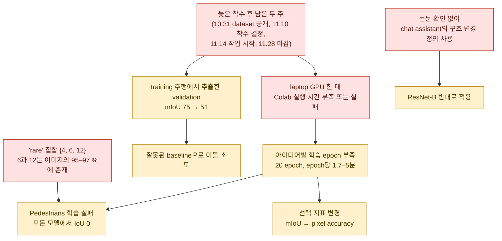
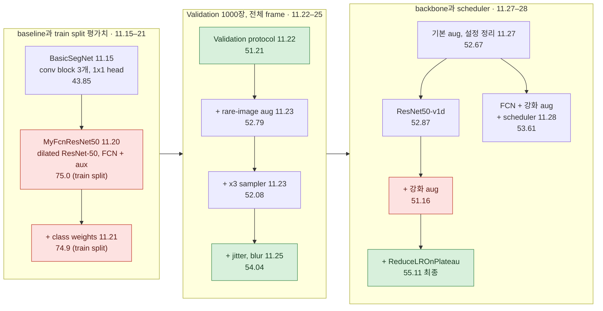
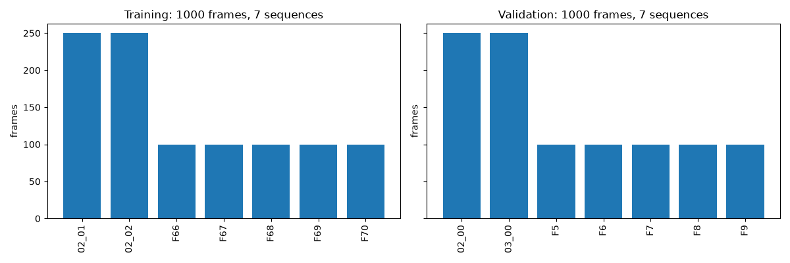
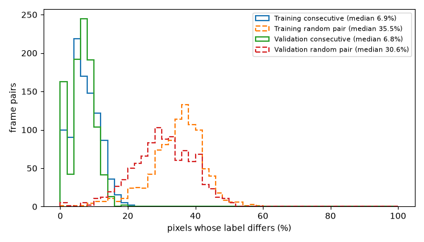
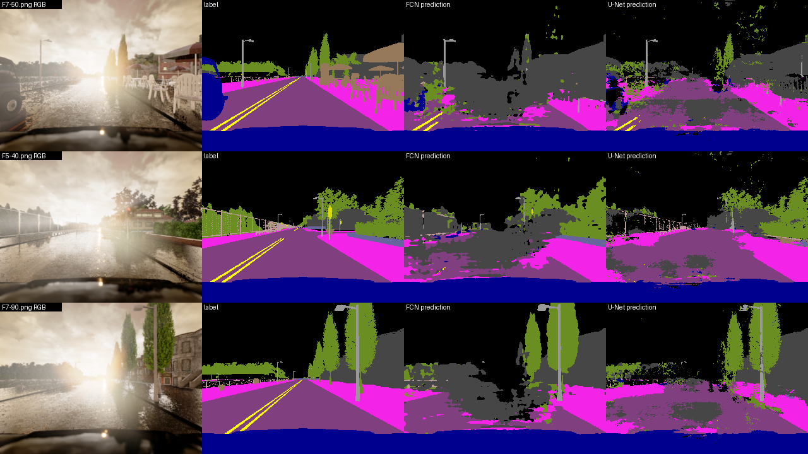
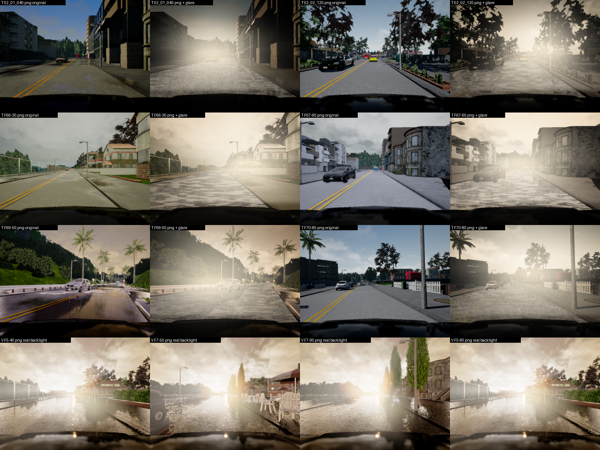
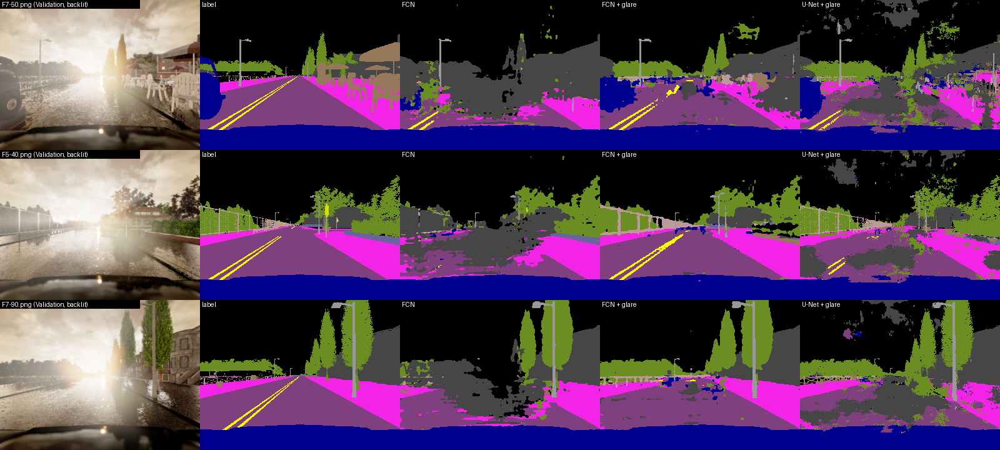
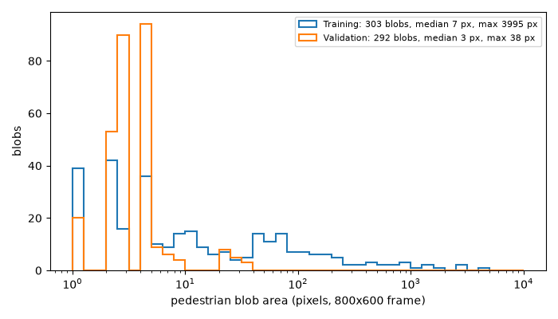

# 회고

[← README](../README_ko.md) · [English](postmortem.md) | **한국어**

## 수치로 본 결과

| 항목 | 값 |
|---|---|
| 최종 모델 | scratch ResNet50-v1d backbone 기반 FCN 강화 augmentation, ReduceLROnPlateau |
| validation (1000장, 800×600) | pixel accuracy 89.78 %, mIoU 55.11 % |
| 성능이 높은 class (IoU) | Vehicles 94.2, None 92.2, Roads 86.1, Sidewalks 75.5, Vegetation 71.4 |
| 성능이 낮은 class (IoU) | Pedestrians 0.0, Other 20.7, Fences 23.8, Walls 36.6, Poles 38.7 |
| per-image pixel accuracy | best 96.75 %, median 93.09 %, worst 63.75 % |
| 작업 기간 | 11.14 → 11.28 (14일) 모든 최종 수치를 GPU laptop 한 대로 산출 |
| 수업 이후 (2026-10) | 동일 모델, 새 recipe: mIoU 60.47 ± 0.89(3 seeds, last epoch) + synthetic backlight augmentation: 63.58 ± 0.38 동일하게 학습한 U-Net과 ensemble: 67.96 ± 0.49([아래](#수업-이후-2026-10)) |

---

## 근본 원인

| # | 문제 | 원인 | 영향 | 교훈 |
|:---:|---|---|---|---|
| 1 | 실제 성능이 아니었던 mIoU 75 % | 연속 Training frame의 random 800 / 200 split | 첫 이틀의 학습 수치를 이후 결과와 비교할 수 없음 | 첫 실행부터 공식 split으로 평가 연속 frame의 random split으로 validation하지 않기 |
| 2 | Pedestrians IoU 0 % | pixel의 0.006 % "rare" 집합이 이미지의 97 %를 포함 | 모든 모델에서 0 % | 희소성을 pixel 단위가 아닌 이미지 단위로 확인 이처럼 작은 class에는 전용 crop이나 loss 항 필요 |
| 3 | 모든 최종 수치를 laptop 한 대로 산출 | Colab 실행 시간 부족 또는 실패 | 실행당 아이디어 하나 seed 반복 없음, sweep 없음 | 공용 연산 자원은 첫날 확보 |
| 4 | 도중에 바뀐 선택 지표 | pixel별 confusion matrix loop가 너무 느림 | 서로 다른 지표로 선택한 실행은 동일 조건의 비교가 아님 | vectorised confusion matrix, 선택 지표 하나 |
| 5 | 학습 불안정 | 이미지 1000장, 고정 Adam 2e-4 | validation accuracy가 10–20포인트 변동 55.11은 epoch 20에 의존 | — |
| 6 | ResNet-B 반대로 적용 | chat assistant의 구조 변경 설명을 논문과 대조하지 않음 | "v1d"는 ResNet-C + D slide 표의 한 항목이 부정확 | 구조 변경은 논문이나 참조 구현과 대조 |
| 7 | augmentation 사용 시 자체 모델 붕괴 | 마감 전 원인 미파악 | 보고된 K-FCNConcat 수치는 augmentation 없는 실행 결과 | — |
| 8 | 모델 학습 후 공부한 이론 | torchvision 구조를 먼저 재구현해 FCN-ResNet 계열 구축 | 학습 후 11.26–28에 이론 공부 | 학습 전에 architecture slide 작성 그 자체가 설계 리뷰 |

추가로, 실행 중에 실험 표 유지(실행 id, recipe, 수치). 
오래된 notebook 사본 세 개 때문에 이 저장소 재구성에 시간 소모.

### 1. training 주행의 random split에서 나온 mIoU 75 %

| Split | 주행 (frames) |
|---|---|
| Training | `02_01`, `02_02`(각 연속 frame 250장) `F66`–`F70`(각 약 100장) |
| Validation | `02_00`, `03_00`, `F5`–`F9` |

양쪽에 겹치는 sequence 없음.

| 날짜 | 평가 대상 | mIoU | Validation vs training loss |
|---|---|:---:|:---:|
| 11.15 | Validation 폴더(baseline) | 43.85 | — |
| 11.20–21 | Training 폴더의 800 / 200 `random_split` | 75.03(전체 frame) 74.93(crop 적용) | 0.19 vs 0.19 |
| 11.22 | Validation 폴더, 800×600 전체 frame | 51.21 | 1.38 vs 0.26 |

- random split에서 같은 sequence의 인접 frame이 양쪽에 배치됨
- 200장 평가치는 일반화보다 암기 성능에 가까움
- 11.22 이후 모든 수치는 Validation 폴더 사용

### 2. Pedestrians: 모든 모델에서 IoU 0 %

| Pedestrians | Training | Validation |
|---|:---:|:---:|
| pixel 비율 | 0.006 % (다음으로 비율이 낮은 TrafficSigns 0.081 %) | 0.0003 % |
| 포함 이미지 비율 | 18 % | 17.7 %(177장) |

- Validation의 보행자 크기는 학습 데이터보다 평균 20× 작음
- 평균 1로 normalize한 class weight 1/log(1.02 + p): Pedestrians 2.04 vs Roads 0.21. 
  pixel imbalance는 3000×인데 weight 비는 10×
- "rare" 집합 {Pedestrians, RoadLines, TrafficSigns}가 ×3 `WeightedRandomSampler`와 강화 augmentation의 기준이었음
  - RoadLines, TrafficSigns가 각각 이미지의 97 %, 95 %에 존재
  - 이미지의 97 %가 rare로 분류되어 sampler 효과는 거의 없었음
  - 11.26–27에 발견했으나 마감 전 수정 못 함
- 800×600 frame에서 512×512 random crop 시 대부분의 sample에서 보행자가 완전히 잘려 나감
- 미실행: 보행자 중심 crop, Pedestrians 전용 sampler, FCN 계열의 Dice / focal loss, Pedestrians weight 상향. 
  (보행자 중심 crop은 11.23에 제안하고 Colab FCN notebook에 작성했으나 미사용.)
- 추정: 보행자 IoU 20 % 달성 시 mIoU 약 1.5포인트 상승 (class 하나가 평균의 1/13)

### 3. 모든 최종 수치를 laptop 한 대로 산출

| 장비 | 실행 내용 |
|---|---|
| Colab | FCN port: 두 epoch 기록(11.22) augmentation FCN: CPU runtime에서 label shape 오류(RGB label을 단일 channel로 변환하지 않음, 11.25) |
| Colab + <nobr>박시현</nobr> 개인 PC | 자체 모델, 자체 pipeline으로 학습 |
| laptop (torch 2.9.1 + CUDA 12.8) | 매 epoch mIoU 계산 시 epoch당 4.2–6.2분 pixel accuracy만 계산 시 epoch당 1.7–2.0분 20-epoch 실행당 35–120분 · 14일간 12회 실행 |

### 4. 도중에 바뀐 checkpoint 선택 기준

| 날짜 | 선택 지표 |
|---|---|
| 11.22 | validation loss |
| 11.23–27 | validation mIoU(patience 5) |
| 11.27–28 | validation pixel accuracy(pixel별 confusion matrix loop가 너무 느려 전환) |

- pixel accuracy는 Roads / None / Vehicles에 유리
- 최종 모델: accuracy는 epoch 20에서 최고, validation loss는 epoch 8에서 최저(1.17). 최고 mIoU epoch이 epoch 20이라는 보장 없음
- 따라서 54.04 실행(mIoU 선택)과 53.61 / 55.11 실행(accuracy 선택)은 동일 조건의 ablation이 아님
- test set 없음 · Validation 폴더를 선택과 보고에 모두 사용(과목에서 허용, slide에 명시)
- 현재: vectorised confusion matrix(`torch.bincount`, `src/autoseg/engine.py`)

### 5. 학습 불안정

- 인접 epoch 사이 validation accuracy가 10–20포인트 하락: 
  v1d 기본 실행 epoch 8에서 64.67 %, v1d 강화 augmentation 실행 epoch 11에서 72.33 %
- training loss는 0.2 부근이나 validation loss는 2.19 / 2.45까지 급등

| 실행 | scheduler 없음 | `ReduceLROnPlateau` 적용 (factor 0.5, validation accuracy 기준 patience 1) |
|---|:---:|:---:|
| v1d + 강화 aug | 51.16(epoch 14에서 중단) | **55.11**(20 epochs) |
| 일반 FCN + 강화 aug | 54.04 | 53.61(선택 지표도 변경됨) |

- v1d에서 scheduler 없는 강화 augmentation은 mIoU 하락(52.87 → 51.16). 
  강한 augmentation에 필요한 epoch 수를 채우기 전에 early stop 발생

2026-10 최종 recipe 재실행(`src/autoseg`, RTX 4070 Ti):

| 실행 | Early stop | 저장한 epoch | Pixel acc | mIoU |
|---|:---:|:---:|:---:|:---:|
| torch 2.14, accuracy 선택 | epoch 18 | 13 | 87.37 | 51.90 |
| 원래 env(torch 2.9.1), accuracy 선택 | epoch 16 | 11 | 89.46 | 51.80 |
| 원래 env, `--select miou` | — | 17 | 89.53 | 54.87 |

- torch 2.9.1 accuracy 실행에서 mIoU는 epoch 14의 53.57 %가 최고였으나 accuracy 기준이라 미저장
- 수업 당시 run은 validation accuracy가 epoch 20까지 조금씩 올라 55.11 %에 도달
- vectorised confusion matrix 사용 시 추가 비용 없는 `--select miou` · 수업 당시 run보다 0.24점 낮음
- 같은 env에서 51.80 vs 54.87의 차이가 §4 지표 전환의 비용

### 6. ResNet-B 반대로 적용

| 구조 변경 (Bag of Tricks, He et al., 2019) | 정의 | v1d 코드 |
|---|---|---|
| ResNet-B | stride를 1×1 conv1에서 3×3 conv2로 이동 | 반대로 적용: conv1에 stride 배치 (원래 `MyFcnResNet50`은 이미 conv2에 배치, torchvision 구조) |
| ResNet-C | 7×7 stem을 3×3 conv 세 개로 교체 | 정의대로 적용 |
| ResNet-D | AvgPool + 1×1 conv로 shortcut downsampling | 정의대로 적용 |

- 11.27 코딩 시 사용한 설명은 B가 반대로 되어 있었음
- 따라서 "v1d" backbone은 ResNet-B를 적용하지 않은 bottleneck에 ResNet-C + D 적용
- stride가 있는 block은 layer2 첫 block뿐이라 수치 영향은 작음. 
  모델 비교 표의 "ResNet-B + ResNet-D" 항목은 부정확
- 같은 출처의 다른 미확인 주장: torchvision aux loss weight(0.4가 아닌 0.5)

### 7. augmentation 학습 붕괴 (자체 모델)

| `khaha`, 20 epochs | mIoU |
|---|:---:|
| augmentation 없음 | 52.16 |
| augmentation dataset 사용 | 3.67 (None 34, Vegetation 10, Poles 3, 나머지 전부 0) |

- 마감 전 원인 미파악 · 후보:
  - 이미지와 mask의 독립 변환
  - 한쪽 dataset class에만 normalization 적용
  - interpolation으로 label 값 변경
- 보고된 K-FCNConcat 수치(49.45 / 52.16 / 51.61)는 augmentation 없는 실행 결과
- slide의 개선 버전(BatchNorm, 단일 conv6, augmentation, scheduler)은 남아 있는 notebook 없음

### 8. 모델 학습 후 공부한 이론 (FCN-ResNet 계열)

- 팀 이론의 바탕: <nobr>박시현</nobr>·<nobr>오효정</nobr>의 정리(FCN, U-Net, transposed convolution, ResNet · 11.19–11.27)
- FCN-ResNet 계열은 torchvision 구조를 먼저 재구현함
- 학습 후 11.26–28에 slide를 작성하며 이론 공부: 
  ResNet degradation vs vanishing gradient, constructed solution, FCN upsampling, aux head
- 12.01 Q&A 준비 중 발견한 미해결 사항: 
  augmentation 빈도 vs 강도, B/C/D가 적용되는 bottleneck, early stop의 의미

---

## 시도 후 중단한 접근

| 아이디어 | 담당 / 시점 | 결과 |
|---|---|---|
| Mini U-Net baseline + ASPP 방식 dilated bottleneck + CE + Dice (착수 전략 초안) | <nobr>김채연</nobr>, 11.14 | 미채택 대신 FCN-ResNet50 구조 구현 |
| 비교 모델로 torchvision `deeplabv3_resnet50(weights=None)` 사용 | <nobr>김채연</nobr>, 11.23 | 계획만 수립, 미실행 |
| 13개 class가 모두 포함된 이미지만 학습 | <nobr>김채연</nobr>, 11.25 | 대부분의 데이터가 제외되어 기각 |
| vertical flip, solarize, cutout | <nobr>박시현</nobr> augmentation 계획 11.21–25 | 주행 장면에 부적합해 vertical flip 기각 solarize 미구현 albumentations API 변경으로 cutout이 비활성화된 사실을 놓침 |
| UPerNet, DCN backbone | <nobr>박시현</nobr>, 11.21 | 조사 후 시간 부족으로 미구현 |
| 보행자 중심 crop | 아이디어 <nobr>김채연</nobr> 11.21 코드 <nobr>오효정</nobr> 11.22–25 | Colab FCN notebook에 작성 학습에는 미연결 |
| FCN 계열의 dilated-bottleneck decoder | <nobr>김채연</nobr>, 11.23 | backbone 전환을 택해 중단 |

---

## 모델 변천

병행 실험:

- <nobr>박시현</nobr>의 `khaha`(U-Net 방식 concat decoder): 49.45 → 52.16 → BatchNorm·CE + Dice 적용 후 51.61
- slide용 U-Net / U-Net++ 비교(수치는 slide에만 기록)
- <nobr>오효정</nobr>의 class 비율 기반 augmentation 적용 Colab FCN-ResNet50(완료된 실행 없음)

---

## 실험 기록

학습 설정과 per-class IoU 전체 표: 
[results/experiments.csv](../results/experiments.csv), [results/class_iou.csv](../results/class_iou.csv)

| 실행 | 변경 | pixel accuracy | mIoU | 비고 |
|---|---|---|---|---|
| C00 11.15 | 3-block CNN, augmentation 없음 | 82.95 | 43.85 | |
| C01 11.20 | scratch FCN-ResNet50, 전체 frame, weights 없음 | 96.53 | 75.03 | train split 평가치 |
| C02 11.21 | class weights, flip + crop, 20 epoch | 95.55 | 74.93 | train split 평가치 |
| C04 11.22 | Validation 1000장 전체 frame, blur 제거 | 87.73 | 51.21 | Validation set 기준 첫 수치 |
| C05 11.23 | rare-image augmentation 계수 1.0 / 0.4, raw weights | 88.50 | 52.79 | |
| C06 11.23 | normalised weights, ×3 sampler | 87.50 | 52.08 | |
| C07 11.25 | jitter 0.7–1.3, rare image에 blur 1.5 best epoch 17 | 90.17 | 54.04 | mIoU 선택 |
| C08 11.27 | 기본 augmentation (flip + crop) | 87.61 | 52.67 | slide "Basic" 열 |
| C09 11.27 | ResNet50-v1d, 기본 augmentation | 88.02 | 52.87 | epoch 17 early stop epoch 8 validation accuracy 64.67 |
| C10 11.27 | v1d + 강화 augmentation | 86.90 | 51.16 | epoch 14 early stop |
| C11 11.27 | v1d + 강화 augmentation + scheduler | **89.78** | **55.11** | 최종 |
| C12 11.28 | FCN-ResNet50 + 강화 augmentation + scheduler | 90.16 | 53.61 | epoch 17 early stop |
| S03 11.25 | khaha + BN, CE + Dice | — | 51.61 | 이전 khaha 실행: 49.45 (10 epoch), 52.16 (20 epoch), 3.67 (augmentation) |

표에서 제외한 오래된 사본:

- `251123_0249` (`251123_0030`과 출력 동일)
- `251125_1523` (`251125_0035`와 출력 동일)
- `251121_2136` (training split 출력)

---

## troubleshooting 로그

| 날짜 | 증상 | 원인 | 조치 |
|---|---|---|---|
| 11.21 | `evaluate_seg`에서 `TypeError` | class weights 인자 미지원 loss를 잘못된 개수로 나눔 | signature와 normalization 수정 |
| 11.21 | `UserWarning: Argument(s) 'max_holes, max_height, max_width, fill_value, mask_fill_value' are not valid for transform CoarseDropout` | albumentations API 변경 | 무시함 · cutout 사실상 비활성 |
| 11.21 | `ModuleNotFoundError: No module named 'cv2'` | OpenCV 없는 laptop에서 albumentations script 실행 | script는 Colab에서만 사용 |
| 11.22 | `RuntimeError: Sizes of tensors must match except in dimension 1. Expected size 76 but got size 75` `torch.cat((x, skip4))`에서 발생 | 800×600 입력이 2⁵로 나누어떨어지지 않음 | concat 전 `F.interpolate(x, size=skip.shape[2:])` |
| 11.22 | 11.20‑21 mIoU 75, 11.22 mIoU 51 | training 주행의 random split에서 validation 추출 | Validation 폴더 |
| 11.25 | `RuntimeError: only batches of spatial targets supported (3D tensors) but got targets of dimension: 4` (Colab FCN) | RGB label PNG를 단일 channel로 변환·resize하지 않음 | 마감 전 미수정 |
| 11.25 | augmentation 사용 시 자체 모델 mIoU 3.67 | 미파악 | augmentation 제외 |
| 11.26 | Colab FCN notebook에서 mIoU 미출력 | `evaluate_miou`를 정의만 하고 호출 안 함 | 호출 추가 |
| 11.27 | `out += identity`에서 `RuntimeError` 128 vs 127, 64 vs 128 | AvgPool kernel ≠ stride, 이후 downsampling 없는 shortcut 적용 v1d backbone port 중 발생 | `AvgPool2d(stride, stride, ceil_mode=True)` + 1×1 conv |
| 11.27 | `TypeError: ReduceLROnPlateau.__init__() got an unexpected keyword argument 'verbose'` | torch 2.9에서 제거됨 | 인자 삭제 |
| 11.27 | `TypeError: unsupported operand type(s) for *: 'NoneType' and 'int'` 곡선 plot에서 발생 | accuracy 전용 validation으로 바꾼 뒤 epoch별 mIoU list가 비어 있음 | plot cell 수정 |

---

## 수업 이후 (2026-10)

동일한 장비에서 2026-10-11부터 10-17까지 <nobr>김채연</nobr>이 확인한 세 가지 질문:

1. 더 나은 training recipe를 적용한 수업 모델(ResNet50-v1d backbone FCN, pretrained weights 없음)의 도달 성능은?
2. EDA에서 놓친 frame sequence를 고려하면 무엇이 달라지는가?
3. 남은 오류의 발생 지점은?

파일:

- 실행: [results/postcourse_runs.csv](../results/postcourse_runs.csv)
- 역광과 나머지 주행 비교: [results/postcourse_backlit.csv](../results/postcourse_backlit.csv)
- 명령: [experiments/postcourse/](../experiments/postcourse/README.md)

> 별도 test set이 제공되지 않아, Validation set은 학습에는 사용하지 않고 checkpoint와 hyperparameter 선택, 결정 보정 맞춤에 사용했다. 보고한 수치는 모두 Validation 기준이다. 
> Synthetic backlight augmentation(§3)은 역광 Validation frame과 비교해 설계 
> Screening과 채택 기준은 해당 실행 전에 기록

### Training 속도

recipe 변경 전 512 crop 기준 epoch당 115 → 41 s(전체 frame 62 s) 
100-epoch 실행 약 1시간 50분

| 변경 | s / epoch |
|---|:---:|
| Persistent workers와 pinned memory | 115 → 83 |
| PNG decode cache(`--cache-dir`) | 83 → 81 |
| bf16 autocast | 81 → 45 |
| channels_last | 45 → 42 |
| `cudnn.benchmark` | 42 → 41 |

### 1. 수업 모델의 도달 성능

결정 지표: last 5 epochs의 평균 Validation mIoU 
각 단계는 seeds 42, 1, 2의 평균 ± 표준편차

| 단계 | 변경 | Last 5 epochs | Last epoch | Best epoch |
|---|---|:---:|:---:|:---:|
| 0 | 수업 recipe 재실행 Adam 2e-4, ReduceLROnPlateau, 20 epochs, 512 crop, pixel accuracy 기준 early stop | 51.95 ± 1.79 | 52.71 ± 1.71 | 52.81 ± 1.75 |
| 1 | Cosine schedule(1 warm-up epoch), 30 epochs, early stop 없음 | 53.78 ± 0.97 | 53.82 ± 1.08 | 54.11 ± 0.92 |
| 2 | AdamW 5e-4, weight decay 1e-2 | 55.77 ± 1.14 | 55.73 ± 1.25 | 56.14 ± 1.16 |
| 3 | 512 crop 대신 800×600 전체 frame | 56.98 ± 0.31 | 57.05 ± 0.31 | 57.25 ± 0.40 |
| 4 | 60 epochs | 58.82 ± 0.66 | 58.86 ± 0.71 | 59.51 ± 0.43 |
| 5 | + 0.5 Dice, 100 epochs(**새 recipe**) | 60.52 ± 0.87 | **60.47 ± 0.89** | 60.96 ± 0.64 |
| 6 | + Training 이미지 30 %에 synthetic backlight(§3) | 63.65 ± 0.34 | **63.58 ± 0.38** | 64.02 ± 0.18 |

- 수업 규칙(pixel accuracy 기준 checkpoint 선택)을 적용한 단계 0: 52.64 ± 2.03
- 참고용 수업 run: 55.11(one seed)

단계 1 이전, 수업 pipeline 단일 seed 실행(30 epochs, Windows):

| 변경 | mIoU |
|---|:---:|
| flip + crop 대신 강화 augmentation | +1~+2 |
| ReduceLROnPlateau | −0.9~−1.2 |
| patience 10 early stop(best epochs 28–30) | −1.0~−1.4 |

확인 후 미채택:

| 변경 | 결과 | 비교 대상 |
|---|:---:|---|
| weights EMA(0.999) | 54.10 | cosine 54.24(seed 42) |
| Poly schedule | 53.36 | cosine 54.24 |
| SGD 0.01 / 0.02 | 51.61 / 51.29 | AdamW 5e-4 56.48(seed 42) |
| Batch 8 | 55.48 | batch 4 56.48 |
| 일반 FCN-ResNet50 backbone | 54.42 ± 0.36 | C+D 55.77 ± 1.14(단계 2) |
| B+C+D backbone(ResNet-B 추가) | 55.90 ± 0.38 | C+D 55.77 ± 1.14 수업 모델인 C+D 유지 |
| 576×768 crop | 56.67 | 전체 frame 56.98 ± 0.31 |
| Scale augmentation 0.75–1.5 | 57.71 | screening 기준 59.32 |
| Two-frame input(t−1과 t를 6 channels로 입력) | 58.00 | screening 기준 59.32 |

Screening: seed 42, 전체 frame, 60 epochs · 단계 4 평균 + 0.5 = 59.32 초과 시 유지 
Dice 0.5 → 59.99, 100 epochs → 59.42 · 둘 다 유지해 단계 5에서 결합

세 단계 5 모델(last epoch)의 inference-only 결과:

| Variant | mIoU |
|---|---|
| One forward pass | 60.47 ± 0.89 |
| Flip TTA | 60.63 ± 1.00 |
| Multi-scale TTA(0.75 / 1 / 1.25, 각각 flip 포함) | 59.58 ± 1.01 |
| Logit adjustment −τ·log(class prior) | 모든 fold에서 최적 τ가 −0.125~0: 변화 없음 |
| Flip TTA + 클래스별 결정 보정, 다른 여섯 sequence에 보정 맞춤 | 61.15 ± 0.73 |
| Flip TTA + 클래스별 결정 보정, 전체 Validation에 보정 맞춤 | 61.83 ± 0.72 (seed 42 / 1 / 2: 61.57 / 62.64 / 61.28) |

맞춘 보정값: 모든 fold에서 Buildings −2.3, Poles 약 −2.1, TrafficSigns 약 +0.9.

| seed 평균 | 보정 없음 | 보정 적용 |
|---|:---:|:---:|
| Other를 Buildings로 예측(Other pixel의 %) | 44.0 % | 38.6 % |
| Walls를 Buildings로 예측 | 27.7 % | 20.6 % |
| RoadLines를 Roads로 예측 | 13.7 % | 22.3 % |
| Buildings IoU | 65.2 | 70.2 |

결정 보정 맞춤 방법

 

- class별 log p + b의 argmax로 prediction, class당 b 하나(None은 0으로 고정)
- stride-4 pixel grid에서 ±2 범위 coordinate ascent로 탐색
- `autoseg.calibrate`, `evaluate --bias-json`으로 적용
- 각 Validation sequence는 다른 여섯 sequence에 맞춘 보정으로 평가하고 합산한 결과가 61.15 행
- 같은 검증의 ±4 탐색 결과 61.02

### 2. EDA에서 놓친 점: frame은 sequence

| Frames | Training | Validation |
|---|:---:|:---:|
| 주행 | 7(각 250 frames인 주행 둘, 각 100 frames인 주행 다섯) | 7(각 250 frames인 주행 둘, 각 100 frames인 주행 다섯) |
| 연속 frame 간 pixel 차이(median) | 6.9 % | 6.8 % |
| random pair 간 pixel 차이 | 35.5 % | 30.6 % |

- 양쪽에 공통된 주행 없음
- Training의 random 800 / 200 split에서는 각 validation frame의 유사 frame이 training에 포함: 
  해당 split 74.93(11.21) vs Validation 51.21(11.22)

단계 5 모델의 per-sequence mIoU(3 seeds 평균):

| Sequence | 02_00 | 03_00 | F5 | F6 | F7 | F8 | F9 |
|---|:---:|:---:|:---:|:---:|:---:|:---:|:---:|
| mIoU | 67.2 | 65.5 | **35.6** | 54.9 | **33.1** | 75.2 | 59.9 |

인접 frame 사용:

| 방법 | mIoU | one frame 대비 |
|---|:---:|:---:|
| t−1, t, t+1 probability 평균 | 54.30 | −6.2 |
| DIS optical flow로 t−1 warp, forward-backward consistency mask 적용 후 t와 평균 | 60.53 | +0.06 |
| t−1과 t+1에 동일 적용 | 60.75 | +0.28 |
| Two-frame input(seed 42, 60 epochs) | 58.00 | 단계 4: 58.82 |
| 고정 backbone의 ConvGRU head(3-frame clips, 10 epochs) GRU 없는 동일 head를 뺀 값 | −0.07(3-frame window) −0.20(전체 sequence) | — |

frame 평균의 효과가 작은 이유:

| 지표(단계 5 모델) | 값 |
|---|:---:|
| Flicker, one frame | 2.48–2.57 % |
| Flicker, flow-aligned 평균 | 1.48–1.54 % |
| ground-truth label의 flicker | 1.57 % |
| frame당 오답 pixel(1 − pixel accuracy) | 7.7–9.1 % |
| frame 사이 변화 pixel | 2.5 % |

- Flicker: ground truth가 변하지 않는 flow-aligned 좌표에서 연속 frame 사이 predicted label이 바뀐 pixel 비율
- 인접 frame 평균은 변화하는 pixel에만 작용 가능

| 평균 대상 prediction | 향상 폭 |
|---|---|
| 단일 모델의 인접 frame | +0.3 |
| 동일 architecture 세 seeds | +0.8(FCN) / +1.5(U-Net) |
| FCN + U-Net(§5) | U-Net 대비 +2.0, FCN 대비 +4.2 |

평균 대상 prediction의 차이가 클수록 향상 폭도 큼.

### 3. 역광 주행: Training에 없는 조건

- F5와 F7은 sequence 전체가 정면 햇빛 역광이며 Training sequence 중에는 없음
- 단계 5 모델 여섯 개(FCN, U-Net 각 3 seeds) 모두 pixel accuracy 하위 10 % frame이 전부 F5 또는 F7
- 수업 모델의 최저 이미지(63.75 %, F7-50)도 해당

F5 + F7에서 실패한 class(FCN, 3 seeds 평균):

| Class | 나머지 다섯 주행 | F5 + F7 |
|---|:---:|:---:|
| Roads | 96.7 | 51.6 |
| RoadLines | 74.2 | 7.4 |
| Buildings | 89.7 | 21.1 |
| Sidewalks | 85.2 | 59.1 |

- glare가 비친 젖은 도로를 Buildings로 예측(도로 pixel의 35 %)하고 RoadLines는 사라짐 · U-Net도 같은 방식으로 실패
- 인접 frame도 효과 없음: F5 + F7의 flow-aligned 평균 36.60(FCN), 33.68(U-Net) vs one frame 36.67, 33.56

`data.add_glare`(`train --glare P`):

| 부분 | 효과 |
|---|---|
| 전체 이미지 | sepia wash, 더 어두운 mid-tone(silhouette), 밝은 하늘 |
| 수평선 | diffuse glow |
| 태양 아래 도로 | 넓어지는 반사광 |
| 도로 pixel(label 기준) | 얼룩진 젖은 texture와 speck 수평선 위 장면을 비추는 평평한 물웅덩이 |

F5 / F7 frame과 비교해 형태 조정(Validation 이미지는 확인에만 사용, 학습에는 미사용).

학습 전 검증(`experiments/postcourse/glare_check.py`): 
역광이 아닌 다섯 Validation 주행에 synthetic glare를 적용하고 단계 5 모델로 평가.

| 모델 | 나머지 다섯 주행 | + synthetic glare | 실제 F5 + F7 |
|---|:---:|:---:|:---:|
| FCN | 67.13 | 40.22 | 36.67 |
| U-Net | 70.65 | 32.14 | 33.56 |

실제 오류와 유사한 결과: RoadLines 5.7(실제 7.4), road → Buildings 15.6 %(실제 35 %).

학습:

- 새 recipe와 seeds 42 / 1 / 2, Training 이미지 30 %에 glare
- glare는 별도 random stream을 사용해 initialization, sampling 순서, flip, crop은 glare 없는 실행과 동일
- 실행 전 확정한 기준:
  - 세 seeds 모두 F5 + F7에서 동일 seed 모델보다 높고 평균 +3 이상
  - 나머지 다섯 주행 평균 변화 −0.5 이상

| 모델(3 seeds, last epoch) | 전체 7개 주행 | F5 + F7 | 나머지 다섯 |
|---|:---:|:---:|:---:|
| FCN | 60.47 ± 0.89 | 36.67 | 67.13 |
| FCN + glare 30 % | **63.58 ± 0.38** | **50.56** | 66.86 |
| U-Net | 62.70 ± 0.50 | 33.56 | 70.65 |
| U-Net + glare 30 % | **65.06 ± 0.30** | 42.09 | **72.18** |

glare 모델 minus 동일 seed 모델(seeds 42 / 1 / 2):

| 모델 | F5 + F7 | 나머지 다섯 | 전체 주행 | 기준 |
|---|:---:|:---:|:---:|:---:|
| FCN | +14.5 / +10.2 / +17.0 (평균 +13.9) | +0.05 / −0.16 / −0.72 (평균 −0.28) | +3.8 / +1.9 / +3.6 (평균 +3.1) | 충족 |
| U-Net | +6.4 / +12.2 / +7.0 (평균 +8.5) | +1.7 / +1.1 / +1.8 (평균 +1.5) | +1.9 / +3.1 / +2.1 (평균 +2.4) | 충족 |

- F5 + F7의 FCN seed 범위 33.8–40.2, glare FCN 50.4–50.8
- pixel accuracy 하위 10 % frame 중 F5 / F7 비율: 
  glare FCN 52 / 73 / 58 %(seeds 42 / 1 / 2), glare U-Net은 계속 100 %

class별, 3 seeds 평균:

| Class | FCN | Glare FCN |
|---|:---:|:---:|
| Roads | 87.2 | 95.4 |
| Buildings | 65.2 | 83.2 |
| RoadLines | 62.1 | 70.9 |
| Walls | 48.0 | 42.0 |
| TrafficSigns | 66.8 | 64.2 |

### 4. FCN vs U-Net

Classic U-Net(same padding + BatchNorm, 31.0 M parameters, aux head 없음, pretrained weights 없음) 
동일한 recipe와 seeds 42, 1, 2

수업에서 FCN-ResNet50을 선택한 이유:

- 대부분의 팀이 U-Net 계열 모델을 사용할 것으로 예상 · 모델 설계 창의성 30점
- 따라서 일반적으로 성능이 낮은 오래된 architecture로 어디까지 갈 수 있는지 보여주는 것이 목표
- U-Net은 GPU memory 1.5–1.6배 필요(아래 표)
- slide 결과: U-Net 48.69, U-Net++ 44.73(10 epochs, <nobr>박시현</nobr>) vs FCN-ResNet50 55.11

| Recipe(3 seeds) | FCN-ResNet50-v1d | U-Net |
|---|:---:|:---:|
| 수업 recipe(pixel accuracy 기준 checkpoint) | **52.64 ± 2.03** | 50.87 ± 1.90 |
| 새 recipe, last epoch | 60.47 ± 0.89 | **62.70 ± 0.51** |
| 새 recipe, best epoch | 60.96 ± 0.64 | 63.84 ± 0.94 |
| 새 recipe + flip TTA + 결정 보정, 다른 여섯 sequence에 보정 맞춤 | 61.15 ± 0.73 | 63.48 ± 0.72 |
| 새 recipe + flip TTA + 결정 보정, 전체 Validation에 보정 맞춤 | 61.83 ± 0.72 | 64.29 ± 0.62 |
| 새 recipe + glare 30 %, last epoch | 63.58 ± 0.38 | **65.06 ± 0.30** |
| Peak GPU memory, 512 crop / 전체 frame (batch 4, bf16) | 3.2 / 5.5 GB | 4.8 / 8.8 GB |
| epoch당 시간, 512 crop / 전체 frame | 40 / 64 s | 45 / 73 s |

수업 recipe → 새 recipe: FCN +7.8, U-Net +11.8(last epoch · 수업 recipe는 수업 당시 선택 규칙 적용).

새 recipe의 최고 단일 seed(FCN seed 1, U-Net seed 42):

| 평가 | FCN-ResNet50-v1d(seed 1) | U-Net(seed 42) |
|---|:---:|:---:|
| Last epoch | 61.45 | 63.22 |
| Best epoch | 61.70(epoch 71) | 64.65(epoch 71) |
| + flip TTA + 결정 보정, 다른 여섯 sequence에 맞춤 | 61.99 | 64.22 |
| + flip TTA + 결정 보정, 전체 Validation에 맞춤 | **62.64** | **64.84** |

새 recipe의 per-class IoU, U-Net minus FCN(3 seeds 평균, 전체 주행):

| Class | Fences | RoadLines | Vegetation | Buildings | TrafficSigns | Walls | Vehicles | Roads |
|---|:---:|:---:|:---:|:---:|:---:|:---:|:---:|:---:|
| U-Net − FCN | +15.4 | +15.1 | +5.5 | +4.8 | +3.9 | −11.6 | −2.4 | −2.0 |

Pedestrians는 둘 다 0. F5 + F7에서는 FCN 우세:

| F5 + F7 | Roads | Walls | Vehicles |
|---|:---:|:---:|:---:|
| FCN | 51.6 | 42.2 | 96.6 |
| U-Net | 41.7 | 19.7 | 89.0 |

U-Net, inference only

 

- Flip TTA 62.95 ± 0.43, multi-scale TTA 62.70 ± 0.33, flow-aligned t±1 62.52 ± 0.51
- Logit adjustment 최적 τ +0.125~+0.5(FCN: −0.125~0), cross-check +0.01~+0.04

Context 검증(`experiments/postcourse/context_check.py`, 재학습 없음, 단계 5 모델, 3 seeds): 
frame의 400×300 사분면을 각각 prediction 후 결합

| 모델 | 나머지 다섯 주행 | F5 + F7 |
|---|:---:|:---:|
| FCN | 67.13 → 54.26 | 36.67 → 28.89 |
| U-Net | 70.65 → 62.86 | 33.56 → 28.74 |

- frame의 나머지 영역이 없으면 F5 + F7에서 FCN의 우세 소멸: 
  Roads 51.6 → 35.8 vs U-Net 41.7 → 35.4
- U-Net의 RoadLines는 거의 변화 없음: 98.0 → 97.6(FCN 74.2 → 55.0)

### 5. Ensemble

softmax 동일 가중치 평균, 가중치 맞춤 없음(`autoseg.ensemble`) 
같은 seed끼리 pair, 세 pair의 평균 ± 표준편차

| Ensemble | 전체 7개 주행 | F5 + F7 | 나머지 다섯 |
|---|:---:|:---:|:---:|
| FCN seeds 42 + 1 + 2 | 61.29 | 37.95 | 67.89 |
| U-Net seeds 42 + 1 + 2 | 64.17 | 35.52 | 71.98 |
| FCN + U-Net | 64.68 ± 0.70 | 37.49 | 72.38 |
| FCN + glare FCN | 63.53 ± 0.47 | 47.31 | 68.00 |
| Glare FCN + U-Net | 67.11 ± 0.54 | 46.79 | 72.46 |
| **Glare FCN + glare U-Net** | **67.96 ± 0.49** | 50.07 | 73.00 |
| 모델 여섯 개 전체: FCN × 3 + U-Net × 3 | 65.44 | 38.53 | 73.11 |
| 모델 여섯 개 전체: glare FCN × 3 + glare U-Net × 3 | **69.00** | **52.06** | **73.69** |

- 서로 다른 architecture 두 개(64.68)가 단일 architecture 세 seeds(U-Net 64.17)보다 높음
- FCN + glare FCN은 계산량이 두 배지만 glare FCN 단독과 동일(63.53 vs 63.58)
- Flip TTA 적용: glare FCN + glare U-Net 68.17 ± 0.47, glare 모델 여섯 개 전체 69.08

class별 FCN + U-Net(3 pairs 평균):

| Class | FCN | U-Net | FCN + U-Net |
|---|:---:|:---:|:---:|
| Walls | 48.0 | 36.4 | 47.2 |
| RoadLines | 62.1 | 77.2 | 77.2 |
| Poles | — | — | 58.6(두 구성 모델보다 높음) |
| Sidewalks | — | — | 82.2(두 구성 모델보다 높음) |

### 6. Pedestrians

| Pedestrian blob(8-connected) | Training | Validation |
|---|:---:|:---:|
| 개수 | 303 | 292 |
| median area(pixels) | 7 | 3 |
| 최대 area(pixels) | 3995 | 38 |

수업 이후 모든 모델과 ensemble의 Pedestrians IoU 0 % 
맞춘 결정 보정(Pedestrians +2.05, seed 1) 적용 시에도 동일

### 수업 이후 교훈

| 교훈 | 이유 |
|---|---|
| 탐색 전 결정 지표 확정 | 인접 epoch 사이 Validation mIoU가 수 포인트 변하므로 세 seeds의 last 5 epochs 평균으로 단계 비교 |
| Training 속도부터 측정 | epoch 속도 2.8× 향상으로 GPU 한 대에서 60·100-epoch 실행 가능 |
| EDA에서 frame 순서 확인 | 11.21의 75 %를 설명하며 split 구성 방법을 결정 |
| 추가 조정 전에 주행·class별 오류 분리 | 단계 5 모델 모두의 최저 10 % frame이 역광 주행 두 개에 집중 |
| Synthetic augmentation이 실제 오류를 재현하는지 학습 전에 확인 | 실행 전에 채택 기준도 기록 |
| 서로 다른 지점에서 실패하는 모델을 ensemble | 인접 frame과 단일 모델의 seeds는 같은 오류를 대부분 반복 |
