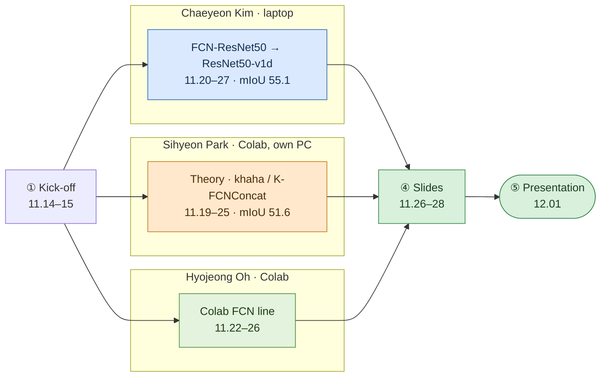

# Repository Guide

[← README](../README.md) · **English** | [한국어](repository_ko.md)

## Folder Tree

```text
Automotive-Artificial-Intelligence/
├── README.md / README_ko.md          Project overview (English / Korean)
├── requirements.txt                  torch, torchvision, numpy, pillow, matplotlib, tqdm, opencv (analyze only)
├── docs/                             timeline, contributions, post-mortem, this guide (en + ko)
│
├── src/autoseg/                      [team, refactored 2026-10] final model as a package
│   ├── data.py                           SegDataset, label loading, 13-class palette, class weights, loaders
│   │                                     [2026-10] add_glare
│   ├── models/fcn_resnet50.py            MyFcnResNet50: scratch dilated ResNet-50 + FCN head + aux head
│   ├── models/fcn_resnet50_v1d.py        FCN_ResNet50_v1d: 3x3 stem, AvgPool shortcut (final backbone)
│   ├── models/heads.py                   FCN head
│   ├── models/resnet50_tricks.py         [2026-10] any subset of ResNet-B/C/D
│   ├── models/unet.py                    [2026-10] classic U-Net for the comparison
│   ├── models/temporal.py                [2026-10] ConvGRU temporal head on a trained backbone
│   ├── engine.py                         train step, evaluation, confusion-matrix IoU, Dice
│   ├── smoke_test.py                     shape and metric check (python -m autoseg.smoke_test)
│   ├── train.py                          CLI: --model --aug --scheduler --select ...
│   │                                     [2026-10] optimizer, schedule, crop, Dice, glare, AMP, resume
│   ├── evaluate.py                       CLI: per-class IoU, prediction figures
│   │                                     [2026-10] --bias-json
│   ├── analyze.py                        [2026-10] TTA, optical-flow averaging, flicker, per-sequence mIoU
│   ├── calibrate.py                      [2026-10] per-class decision bias, leave-one-sequence-out
│   │                                     (writes an evaluate --bias-json file)
│   ├── ensemble.py                       [2026-10] equal-weight ensembles of trained models
│   └── train_temporal.py                 [2026-10] ConvGRU head vs matched control
│
├── experiments/                      [team] notebooks as they were run (outputs kept)
│   ├── chaeyeon/                         00 baseline → 12 enhanced FCN; 11 = final model
│   ├── sihyeon/                          albumentations FCN script, khaha visualisation, khaha model
│   ├── hyojeong/                         Colab FCN-ResNet50, class-ratio augmentation attempts
│   └── postcourse/                       [2026-10] commands of the post-course runs
│                                         glare_check.py, context_check.py
│
├── results/
│   ├── experiments.csv                   every run: recipe, selection metric, pixel acc, mIoU
│   ├── class_iou.csv                     per-class IoU of the key runs
│   ├── rerun_2026-10_fcn_resnet50_v1d_torch214.log
│   │                                     final recipe re-run with src/autoseg (torch 2.14)
│   ├── rerun_2026-10_fcn_resnet50_v1d_torch291.log
│   │                                     same re-run in the original env (torch 2.9.1)
│   ├── rerun_2026-10_fcn_resnet50_v1d_torch291_miou_select.log
│   │                                     same env, checkpoint selected by mIoU (54.87)
│   ├── postcourse_runs.csv               [2026-10] every post-course run: recipe, last / last-5 / best mIoU
│   ├── postcourse_class_iou.csv          [2026-10] per-class IoU of the final models
│   │                                     (plain, flip, decision bias)
│   ├── postcourse_backlit.csv            [2026-10] backlit drives F5 + F7 vs the other five
│   │                                     single models and ensembles
│   └── figures/                          class distribution, per-class IoU chart, final training curves, predictions
│                                         [2026-10] dataset_all.gif, eda_*, postcourse_*, backlit_*, glare_examples
│
└── slides/2025-12-01_final_presentation.pdf   submitted 2025-11-28, presented 2025-12-01
```

Not in the repository:

- the dataset (course-provided; `Training/` and `Validation/` with `RGB/` and `Label/` folders of 800×600 PNGs)
- the checkpoints (`*.pt`, 124–142 MB each)

The GitHub release holds:

- the course checkpoint `ResNet50_BT_ehanced_Augmentation.pt` (55.11)
- two post-course models with synthetic backlight:<br>
  `fcn_resnet50_v1d_glare_seed42.pt` (64.01) and `unet_glare_seed42.pt` (65.07); their ensemble gives 68.49

---

## Notebook Index

| Notebook | Date | Model / change | Result |
|---|---|---|---|
| `chaeyeon/00_251115_first_meeting` | 11.15 | BasicSegNet, full frames, 10 epochs | 82.95 / 43.85 |
| `chaeyeon/01_251120_fcn_resnet50_first` | 11.20 | MyFcnResNet50, Training split 800/200<br>full frame, no class weights | 96.53 / 75.03 (train split) |
| `chaeyeon/02_251121_1511_class_weights` | 11.21 | class weights 1/log(1.02 + p), flip + crop, 20 epochs | 95.55 / 74.93 (train split) |
| `chaeyeon/03_251121_2136_validation_split` | 11.21‑22 | code moved to Training / Validation folders; outputs stale | — |
| `chaeyeon/04_251122_1933_validation_set_eval` | 11.22 | Validation 1000 at full frame, blur removed | 87.73 / 51.21 |
| `chaeyeon/05_251122_2219_rare_class_aug` | 11.23 | `has_rare`, `aug_factor` 1.0 / 0.4, mIoU selection | 88.50 / 52.79 |
| `chaeyeon/06_251123_0030_weighted_sampler` | 11.23 | normalised weights, ×3 `WeightedRandomSampler` | 87.50 / 52.08 |
| `chaeyeon/07_251125_0035_20_epochs` | 11.25 | jitter 0.7–1.3, blur 1.5 on rare images; best epoch 17 | 90.17 / 54.04 |
| `chaeyeon/08_251127_fcn_resnet50_basic_aug` | 11.27 | cleaned recipe, flip + crop only | 87.61 / 52.67 |
| `chaeyeon/09_251127_resnet50_v1d_basic_aug` | 11.27 | `FCN_ResNet50_v1d`, accuracy selection | 88.02 / 52.87 |
| `chaeyeon/10_251127_resnet50_v1d_enhanced_aug` | 11.27 | jitter 0.7–1.3, blur on rare images | 86.90 / 51.16 |
| `chaeyeon/11_251127_resnet50_v1d_enhanced_aug_scheduler_FINAL` | 11.27 | + `ReduceLROnPlateau` | **89.78 / 55.11** |
| `chaeyeon/12_251128_fcn_resnet50_enhanced_aug_scheduler` | 11.28 | same recipe on MyFcnResNet50 | 90.16 / 53.61 |
| `sihyeon/01_251121_fcn_resnet50_albumentations` | 11.21 | FCN-ResNet50 + albumentations, 256×256 | started on Colab; no result kept |
| `sihyeon/02_251122_khaha_visualization` | 11.22 | `khaha` first version, prediction visualisation | — |
| `sihyeon/03_251125_khaha_model` | 11.25 | `khaha` + BatchNorm, weighted CE + Dice, AdamW | — / 51.61 |
| `hyojeong/01_251122_fcn_resnet50_colab_split` | 11.22 | Colab FCN-ResNet50 with class weights, Training split | 2 epochs logged |
| `hyojeong/02_251125_fcn_resnet50_class_ratio_aug`<br>`03_..._v2` | 11.25 | class-ratio flip / rotate augmentation (two Colab copies) | stopped on a label-shape error |

Pixel accuracy / mIoU on the Validation folder unless marked train split.

---

## How the Team Worked



| Phase | Code sharing | Compute | Division of work | Integration |
|---|---|---|---|---|
| ① Kick-off | lecture PDFs, practice notebook<br>article links in chat | laptop | Chaeyeon&nbsp;Kim baseline | — |
| ② Parallel notebooks | notebooks attached in chat | laptop (torch 2.9.1 + cu128)<br>Colab, Sihyeon&nbsp;Park's own PC | FCN line (Chaeyeon&nbsp;Kim)<br>custom model (Sihyeon&nbsp;Park)<br>U-Net / Colab FCN (Hyojeong&nbsp;Oh) | each member ran their own line |
| ③ Imbalance and evaluation | notebooks and `.pt` files in chat | laptop | class weights, sampler, augmentation (Chaeyeon&nbsp;Kim)<br>augmentation plan (Sihyeon&nbsp;Park) | laptop runs become the reference numbers |
| ④ Backbone and slides | notebooks and slide drafts in chat | laptop | EDA / FCN-ResNet (Chaeyeon&nbsp;Kim)<br>2D seg / FCN / FCN→U-Net (Sihyeon&nbsp;Park)<br>U-Net / limitations (Hyojeong&nbsp;Oh) | Sihyeon&nbsp;Park assembles and submits the PDF |
| ⑤ Presentation | — | — | script and Q&A prepared together | — |

- No git was used during the project; this repository was assembled in 2026-10 from the notebooks and the slides.
- Course commits are dated to when the notebooks were written,<br>
  and carry `Co-authored-by` trailers for the member whose code they contain.
- The post-course commits (2026-10) are Chaeyeon Kim's.

---

## Third-party Sources

| Component | Source |
|---|---|
| Dataset | CARLA semantic-segmentation set from the Kaggle Lyft–Udacity challenge<br>(kaggle.com/datasets/kumaresanmanickavelu/lyft-udacity-challenge)<br>as distributed by the course (1000 / 1000 split) |
| FCN-ResNet50 layout | torchvision `fcn_resnet50` (dilated ResNet-50, FCNHead, aux head)<br>re-implemented without pretrained weights |
| ResNet50-v1d tweaks | He et al., "Bag of Tricks for Image Classification with Convolutional Neural Networks", CVPR 2019<br>GluonCV FCN training log (resnet50, ADE20K) as the reference |
| ResNet | He et al., "Deep Residual Learning for Image Recognition", CVPR 2016 |
| Limitations slide | Chen et al., "Adaptive multi-scale feature fusion for semantic segmentation"<br>Multimedia Systems 2021 |
| Class weighting | 1/log(1.02 + p) (ENet-style) |
| U-Net reference | milesial/Pytorch-UNet |
| FCN references | Long et al., CVPR 2015; wkentaro/pytorch-fcn |
