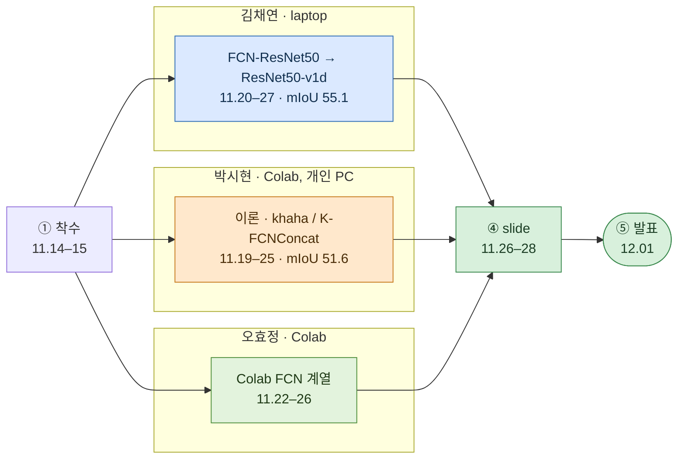

# 저장소 안내

[← README](../README_ko.md) · [English](repository.md) | **한국어**

## 폴더 구조

```text
Automotive-Artificial-Intelligence/
├── README.md / README_ko.md          Project overview (English / Korean)
├── requirements.txt                  torch, torchvision, numpy, pillow, matplotlib, tqdm, opencv (analyze only)
├── docs/                             timeline, contributions, post-mortem, this guide (en + ko)
│
├── src/autoseg/                      [team, refactored 2026-10] final model as a package
│   ├── data.py                           SegDataset, label loading, 13-class palette, class weights, loaders
│   │                                     [2026-10] add_glare
│   ├── models/fcn_resnet50.py            MyFcnResNet50: scratch dilated ResNet-50 + FCN head + aux head
│   ├── models/fcn_resnet50_v1d.py        FCN_ResNet50_v1d: 3x3 stem, AvgPool shortcut (final backbone)
│   ├── models/heads.py                   FCN head
│   ├── models/resnet50_tricks.py         [2026-10] ResNet-B/C/D의 모든 부분 집합
│   ├── models/unet.py                    [2026-10] 비교용 classic U-Net
│   ├── models/temporal.py                [2026-10] 학습된 backbone의 ConvGRU temporal head
│   ├── engine.py                         train step, evaluation, confusion-matrix IoU, Dice
│   ├── smoke_test.py                     shape and metric check (python -m autoseg.smoke_test)
│   ├── train.py                          CLI: --model --aug --scheduler --select ...
│   │                                     [2026-10] optimizer, schedule, crop, Dice, glare, AMP, resume
│   ├── evaluate.py                       CLI: per-class IoU, prediction figures
│   │                                     [2026-10] --bias-json
│   ├── analyze.py                        [2026-10] TTA, optical-flow 평균, flicker, per-sequence mIoU
│   ├── calibrate.py                      [2026-10] 클래스별 결정 보정, leave-one-sequence-out
│   │                                     (evaluate --bias-json 파일 생성)
│   ├── ensemble.py                       [2026-10] 학습된 모델의 동일 가중치 ensemble
│   └── train_temporal.py                 [2026-10] ConvGRU head vs matched control
│
├── experiments/                      [team] notebooks as they were run (outputs kept)
│   ├── chaeyeon/                         00 baseline → 12 enhanced FCN; 11 = final model
│   ├── sihyeon/                          albumentations FCN script, khaha visualisation, khaha model
│   ├── hyojeong/                         Colab FCN-ResNet50, class-ratio augmentation attempts
│   └── postcourse/                       [2026-10] 수업 이후 실행 명령
│                                         glare_check.py, context_check.py
│
├── results/
│   ├── experiments.csv                   every run: recipe, selection metric, pixel acc, mIoU
│   ├── class_iou.csv                     per-class IoU of the key runs
│   ├── rerun_2026-10_fcn_resnet50_v1d_torch214.log
│   │                                     src/autoseg로 최종 recipe 재실행(torch 2.14)
│   ├── rerun_2026-10_fcn_resnet50_v1d_torch291.log
│   │                                     원래 env(torch 2.9.1)에서 같은 재실행
│   ├── rerun_2026-10_fcn_resnet50_v1d_torch291_miou_select.log
│   │                                     같은 env, mIoU 기준 checkpoint 선택(54.87)
│   ├── postcourse_runs.csv               [2026-10] 모든 수업 이후 실행: recipe, last / last-5 / best mIoU
│   ├── postcourse_class_iou.csv          [2026-10] 최종 모델의 per-class IoU
│   │                                     (plain, flip, 결정 보정)
│   ├── postcourse_backlit.csv            [2026-10] 역광 주행 F5 + F7 vs 나머지 다섯 주행
│   │                                     단일 모델과 ensemble
│   └── figures/                          class distribution, per-class IoU chart, final training curves, predictions
│                                         [2026-10] dataset_all.gif, eda_*, postcourse_*, backlit_*, glare_examples
│
└── slides/2025-12-01_final_presentation.pdf   submitted 2025-11-28, presented 2025-12-01
```

저장소 미포함:

- dataset(과목 제공; `Training/`, `Validation/` 아래 800×600 PNG의 `RGB/`, `Label/` 폴더)
- checkpoint(`*.pt`, 각 124–142 MB)

GitHub release 첨부:

- 수업 checkpoint `ResNet50_BT_ehanced_Augmentation.pt`(55.11)
- synthetic backlight를 적용한 수업 이후 모델 두 개:<br>
  `fcn_resnet50_v1d_glare_seed42.pt`(64.01), `unet_glare_seed42.pt`(65.07) · 두 모델의 ensemble 68.49

---

## notebook 목록

| notebook | 날짜 | 모델 / 변경 | 결과 |
|---|---|---|---|
| `chaeyeon/00_251115_first_meeting` | 11.15 | BasicSegNet, 전체 frame, 10 epoch | 82.95 / 43.85 |
| `chaeyeon/01_251120_fcn_resnet50_first` | 11.20 | MyFcnResNet50, Training 800/200 split<br>전체 frame, class weights 없음 | 96.53 / 75.03 (train split 평가치) |
| `chaeyeon/02_251121_1511_class_weights` | 11.21 | class weights 1/log(1.02 + p), flip + crop, 20 epoch | 95.55 / 74.93 (train split 평가치) |
| `chaeyeon/03_251121_2136_validation_split` | 11.21‑22 | 코드를 Training / Validation 폴더 기준으로 변경 · 출력은 이전 값 | — |
| `chaeyeon/04_251122_1933_validation_set_eval` | 11.22 | Validation 1000장 전체 frame 평가, blur 제거 | 87.73 / 51.21 |
| `chaeyeon/05_251122_2219_rare_class_aug` | 11.23 | `has_rare`, `aug_factor` 1.0 / 0.4, mIoU 기준 선택 | 88.50 / 52.79 |
| `chaeyeon/06_251123_0030_weighted_sampler` | 11.23 | normalised weights, ×3 `WeightedRandomSampler` | 87.50 / 52.08 |
| `chaeyeon/07_251125_0035_20_epochs` | 11.25 | jitter 0.7–1.3, rare image에 blur 1.5 · best epoch 17 | 90.17 / 54.04 |
| `chaeyeon/08_251127_fcn_resnet50_basic_aug` | 11.27 | 학습 설정 정리, flip + crop만 사용 | 87.61 / 52.67 |
| `chaeyeon/09_251127_resnet50_v1d_basic_aug` | 11.27 | `FCN_ResNet50_v1d`, accuracy 기준 선택 | 88.02 / 52.87 |
| `chaeyeon/10_251127_resnet50_v1d_enhanced_aug` | 11.27 | jitter 0.7–1.3, rare class 이미지에 blur | 86.90 / 51.16 |
| `chaeyeon/11_251127_resnet50_v1d_enhanced_aug_scheduler_FINAL` | 11.27 | + `ReduceLROnPlateau` | **89.78 / 55.11** |
| `chaeyeon/12_251128_fcn_resnet50_enhanced_aug_scheduler` | 11.28 | 같은 학습 설정을 MyFcnResNet50에 적용 | 90.16 / 53.61 |
| `sihyeon/01_251121_fcn_resnet50_albumentations` | 11.21 | FCN-ResNet50 + albumentations, 256×256 | Colab에서 시작 · 보관된 결과 없음 |
| `sihyeon/02_251122_khaha_visualization` | 11.22 | `khaha` 첫 버전, 예측 시각화 | — |
| `sihyeon/03_251125_khaha_model` | 11.25 | `khaha` + BatchNorm, weighted CE + Dice, AdamW | — / 51.61 |
| `hyojeong/01_251122_fcn_resnet50_colab_split` | 11.22 | class weights 적용 Colab FCN-ResNet50, Training split | 2 epoch 기록 |
| `hyojeong/02_251125_fcn_resnet50_class_ratio_aug`<br>`03_..._v2` | 11.25 | class 비율 기반 flip / rotate augmentation(Colab 사본 두 개) | label shape 오류로 중단 |

train split 표시가 없으면 Validation 폴더 기준 pixel accuracy / mIoU

---

## 팀 작업 방식



| 단계 | 코드 공유 | 연산 자원 | 역할 분담 | 통합 |
|---|---|---|---|---|
| ① 착수 | 강의 PDF, 실습 notebook<br>참고 자료 링크를 채팅으로 공유 | laptop | <nobr>김채연</nobr> baseline | — |
| ② notebook 병렬 작업 | notebook을 채팅에 첨부 | laptop (torch 2.9.1 + cu128)<br>Colab, <nobr>박시현</nobr> 개인 PC | FCN 계열(<nobr>김채연</nobr>)<br>자체 모델(<nobr>박시현</nobr>)<br>U-Net / Colab FCN(<nobr>오효정</nobr>) | 각자 담당 모델 실행 |
| ③ class imbalance와 평가 | notebook과 `.pt` 파일을 채팅에 공유 | laptop | class weights, sampler, augmentation(<nobr>김채연</nobr>)<br>augmentation 계획(<nobr>박시현</nobr>) | laptop 실행 결과를 기준 수치로 사용 |
| ④ backbone과 slide | notebook과 slide 초안을 채팅에 공유 | laptop | EDA / FCN-ResNet(<nobr>김채연</nobr>)<br>2D seg / FCN / FCN→U-Net(<nobr>박시현</nobr>)<br>U-Net / 한계점(<nobr>오효정</nobr>) | <nobr>박시현</nobr>이 PDF 취합·제출 |
| ⑤ 발표 | — | — | 대본과 Q&A를 팀 전원이 함께 준비 | — |

- 프로젝트 기간 중 git 미사용 · 2026-10에 notebook과 slide로 저장소 재구성
- 수업 commit 날짜는 notebook 작성 시점으로 지정하고<br>
  해당 코드 작성자의 `Co-authored-by` trailer 포함
- 수업 이후 commit(2026-10)은 <nobr>김채연</nobr> 작업

---

## 외부 출처

| 구성 요소 | 출처 |
|---|---|
| dataset | Kaggle Lyft–Udacity challenge의 CARLA semantic segmentation dataset<br>(kaggle.com/datasets/kumaresanmanickavelu/lyft-udacity-challenge)<br>과목 배포본 (1000 / 1000 split) |
| FCN-ResNet50 구조 | torchvision `fcn_resnet50` (dilated ResNet-50, FCNHead, aux head)<br>pretrained weights 없이 재구현 |
| ResNet50-v1d 수정 사항 | He et al., "Bag of Tricks for Image Classification with Convolutional Neural Networks", CVPR 2019<br>GluonCV FCN 학습 로그(resnet50, ADE20K)를 참고 자료로 사용 |
| ResNet | He et al., "Deep Residual Learning for Image Recognition", CVPR 2016 |
| Limitations slide | Chen et al., "Adaptive multi-scale feature fusion for semantic segmentation"<br>Multimedia Systems 2021 |
| class weights | 1/log(1.02 + p) (ENet 방식) |
| U-Net 참고 | milesial/Pytorch-UNet |
| FCN 참고 | Long et al., CVPR 2015 · wkentaro/pytorch-fcn |
