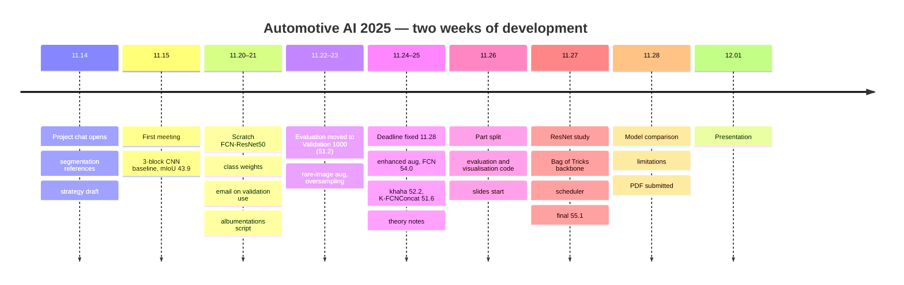

# Timeline

[← README](../README.md) · **English** | [한국어](timeline_ko.md)

## Course Period (2025)

| Date | Event |
|---|---|
| 09.22 | First hands-on session |
| 09.30 | Practice session; individual question assignment announced |
| 10.21 | Midterm exam |
| 10.31 | Project dataset released |
| 11.04 | Autoencoder and RNN lectures |
| 11.10 | Project start set for 11.14 |

---

## Project (2025.11.14 – 12.01)

| Date | Event | Artifact |
|---|---|---|
| 11.14 | Segmentation lecture PDFs, practice notebook and references shared project chat opened | — |
| 11.15 | First meeting 3-block CNN baseline on full frames: pixel acc 82.95, mIoU 43.85 | `chaeyeon/00_251115` |
| 11.19 | FCN and U-Net theory notes (Sihyeon&nbsp;Park) | — |
| 11.20 | Scratch FCN-ResNet50 (dilated ResNet-50, FCN head, aux head) Training folder split 800 / 200 | `chaeyeon/01_251120` |
| 11.21 | Class weights 1/log(1.02 + p) from the EDA Validation set confirmed as evaluation-only (used for model selection) augmentation plan and albumentations script (Sihyeon&nbsp;Park) rare-image augmentation idea | `chaeyeon/02_251121_1511` `sihyeon/01_251121` |
| 11.22 | **First validation-set number**: Validation 1000 at full resolution → 87.73 / 51.21 (the earlier 75 came from a random split of the training drive) custom model `khaha` (Sihyeon&nbsp;Park); Colab FCN port (Hyojeong&nbsp;Oh) | `chaeyeon/04_251122_1933` `sihyeon/02_251122` `hyojeong/01_251122` |
| 11.23 | Rare-image augmentation factor, mIoU-based selection → 52.79 normalised weights + ×3 oversampling → 52.08 full custom pipeline with 13-class palette | `chaeyeon/05`, `chaeyeon/06` |
| 11.24 | Submission deadline confirmed as 11.28 `khaha` 10 epochs → 49.45 | — |
| 11.25 | `khaha` 20 epochs → 52.16, with augmentation → 3.67 FCN with wider jitter and blur → **54.04** `khaha` + BatchNorm + Dice → 51.61 Colab FCN with class-ratio augmentation (label-shape error); FCN / U-Net theory notes | `chaeyeon/07` `sihyeon/03` `hyojeong/02–03` |
| 11.26 | Presentation parts assigned: EDA, FCN-ResNet: Chaeyeon&nbsp;Kim · 2D segmentation, FCN, FCN→U-Net: Sihyeon&nbsp;Park · U-Net, limitations: Hyojeong&nbsp;Oh Colab FCN notebook fix; visualisation and IoU code; slides start | — |
| 11.27 | ResNet paper study; Bag of Tricks check; **backbone switch to ResNet50-v1d** checkpoint selection by pixel accuracy; ReduceLROnPlateau three runs → 52.87 / 51.16 / **55.11 (final)** | `chaeyeon/08–11` |
| 11.28 | FCN with the same recipe → 53.61; U-Net / U-Net++ comparison comparison table; limitations; **PDF submitted** | `chaeyeon/12`, `slides/` |
| 12.01 | Script and Q&A preparation; presentation | — |

---

## Presentation Day (12.01)

- Script and Q&A preparation by the whole team: 
  augmentation frequency vs strength, ResNet-B/C/D, early stopping, scheduler
- Presentation, 10 minutes + Q&A (12.01)

---

## After the Course (2026-10, Chaeyeon Kim)

| Date | Event | Artifact |
|---|---|---|
| 10.11‑12 | Final notebook refactored into `src/autoseg` the original checkpoint reproduces 89.78 / 55.11 re-runs of the final recipe (accuracy vs mIoU selection: 51.80 vs 54.87) | `src/autoseg/` `results/rerun_*` |
| 10.12 | Backbone, augmentation and Bag of Tricks combinations at 30 epochs | `results/postcourse_runs.csv` (stage 1) |
| 10.13 | Runs without early stop; training speed 115 → 41 s per epoch schedule, optimizer, batch and epoch search (decision metric: mean of the last 5 epochs) | stages 2–4 |
| 10.14 | Three seeds per recipe; course recipe re-run 51.95 full frames instead of 512 crops; 60-epoch full-frame baseline 58.82 | stages 0, 4–6 |
| 10.15 | Screening (Dice and 100 epochs kept); **new recipe 60.47 ± 0.89** TTA, optical-flow and ConvGRU checks; per-class decision bias → 61.15 / 61.83 U-Net comparison started | stages 7–9 `src/autoseg/{analyze,calibrate,train_temporal}.py` |
| 10.16 | U-Net comparison finished: 62.70 ± 0.51 under the new recipe ensembles (FCN + U-Net 64.68) per-frame analysis: the 10 % worst frames are all from the backlit drives F5 / F7 synthetic glare designed and checked; glare FCN runs | stage 10 `src/autoseg/ensemble.py` `data.add_glare` |
| 10.17 | **Glare FCN 63.58 ± 0.38** (F5 + F7 +13.9), glare U-Net 65.06 ± 0.30 ensemble glare FCN + glare U-Net 67.96 ± 0.49 context check; documents, release | `results/postcourse_backlit.csv` |
