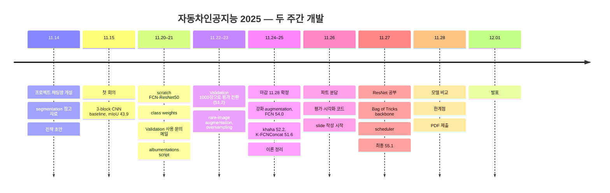

# 연대기

[← README](../README_ko.md) · [English](timeline.md) | **한국어**

## 수업 기간 (2025)

| 날짜 | 내용 |
|---|---|
| 09.22 | 첫 실습 수업 |
| 09.30 | 실습 수업 · 개인 질문 과제 공지 |
| 10.21 | 중간고사 |
| 10.31 | 프로젝트 dataset 공개 |
| 11.04 | autoencoder·RNN 강의 |
| 11.10 | 착수일 11.14로 결정 |

---

## 프로젝트 (2025.11.14 – 12.01)

| 날짜 | 내용 | 산출물 |
|---|---|---|
| 11.14 | segmentation 강의 PDF, 실습 notebook, 참고 자료 공유 프로젝트 채팅방 개설 | — |
| 11.15 | 첫 회의 전체 frame 대상 3-block CNN baseline: pixel accuracy 82.95, mIoU 43.85 | `chaeyeon/00_251115` |
| 11.19 | FCN / U-Net 이론 정리 (<nobr>박시현</nobr>) | — |
| 11.20 | scratch FCN-ResNet50 (dilated ResNet-50, FCN head, aux head) Training 폴더 800 / 200 split | `chaeyeon/01_251120` |
| 11.21 | EDA 기반 class weights 1/log(1.02 + p) Validation set은 평가 전용으로 확인(모델 선택에 사용) augmentation 계획 및 albumentations script (<nobr>박시현</nobr>) rare-image augmentation 아이디어 | `chaeyeon/02_251121_1511` `sihyeon/01_251121` |
| 11.22 | **Validation set 기준 첫 수치**: 원본 해상도 Validation 1000 → 87.73 / 51.21 (이전 75는 training 주행의 random split 평가치) 자체 모델 `khaha` (<nobr>박시현</nobr>) · Colab FCN port (<nobr>오효정</nobr>) | `chaeyeon/04_251122_1933` `sihyeon/02_251122` `hyojeong/01_251122` |
| 11.23 | rare-image augmentation 계수, mIoU 기준 선택 → 52.79 normalised weights + ×3 oversampling → 52.08 13개 class palette를 적용해 직접 구성한 전체 pipeline | `chaeyeon/05`, `chaeyeon/06` |
| 11.24 | 제출 마감 11.28 확정 `khaha` 10 epoch → 49.45 | — |
| 11.25 | `khaha` 20 epoch → 52.16, augmentation 적용 시 → 3.67 FCN jitter 범위 확대·blur 적용 → **54.04** `khaha` + BatchNorm + Dice → 51.61 Colab FCN에 class 비율 기반 augmentation 적용(label shape 오류) · FCN / U-Net 이론 정리 | `chaeyeon/07` `sihyeon/03` `hyojeong/02–03` |
| 11.26 | 발표 파트 분담: EDA, FCN-ResNet: <nobr>김채연</nobr> · 2D segmentation, FCN, FCN→U-Net: <nobr>박시현</nobr> · U-Net, 한계점: <nobr>오효정</nobr> Colab FCN notebook 수정 · 시각화·IoU 코드 · slide 작성 시작 | — |
| 11.27 | ResNet 논문 공부 · Bag of Tricks 확인 · **ResNet50-v1d backbone 전환** checkpoint 선택 기준 pixel accuracy · ReduceLROnPlateau 세 차례 실행 → 52.87 / 51.16 / **55.11 (최종)** | `chaeyeon/08–11` |
| 11.28 | 동일 학습 설정 FCN → 53.61 · U-Net / U-Net++ 비교 비교 표 · 한계점 · **PDF 제출** | `chaeyeon/12`, `slides/` |
| 12.01 | 발표 대본·Q&A 준비 · 발표 | — |

---

## 발표 당일 (12.01)

- 팀 전원 발표 대본·Q&A 준비: 
  augmentation 빈도 vs 강도, ResNet-B/C/D, early stop, scheduler
- 발표, 10분 + Q&A (12.01)

---

## 수업 이후 (2026-10, 김채연)

| 날짜 | 내용 | 산출물 |
|---|---|---|
| 10.11‑12 | 최종 notebook을 `src/autoseg`로 refactoring 원본 checkpoint 89.78 / 55.11 재현 최종 recipe 재실행(accuracy vs mIoU 선택: 51.80 vs 54.87) | `src/autoseg/` `results/rerun_*` |
| 10.12 | 30 epochs 기준 backbone, augmentation, Bag of Tricks 조합 | `results/postcourse_runs.csv` (stage 1) |
| 10.13 | early stop 없는 실행 · Training 속도 epoch당 115 → 41 s schedule, optimizer, batch, epoch 탐색(결정 지표: last 5 epochs 평균) | stages 2–4 |
| 10.14 | recipe당 세 seeds · 수업 recipe 재실행 51.95 512 crop 대신 전체 frame · 60-epoch 전체 frame baseline 58.82 | stages 0, 4–6 |
| 10.15 | Screening(Dice·100 epochs 유지) · **새 recipe 60.47 ± 0.89** TTA, optical-flow, ConvGRU 검증 · 클래스별 결정 보정 → 61.15 / 61.83 U-Net 비교 시작 | stages 7–9 `src/autoseg/{analyze,calibrate,train_temporal}.py` |
| 10.16 | U-Net 비교 완료: 새 recipe에서 62.70 ± 0.51 ensemble(FCN + U-Net 64.68) frame별 분석: pixel accuracy 하위 10 % frame이 모두 역광 주행 F5 / F7 synthetic glare 설계·검증 · glare FCN 실행 | stage 10 `src/autoseg/ensemble.py` `data.add_glare` |
| 10.17 | **Glare FCN 63.58 ± 0.38**(F5 + F7 +13.9), glare U-Net 65.06 ± 0.30 glare FCN + glare U-Net ensemble 67.96 ± 0.49 context 검증 · 문서, release | `results/postcourse_backlit.csv` |
